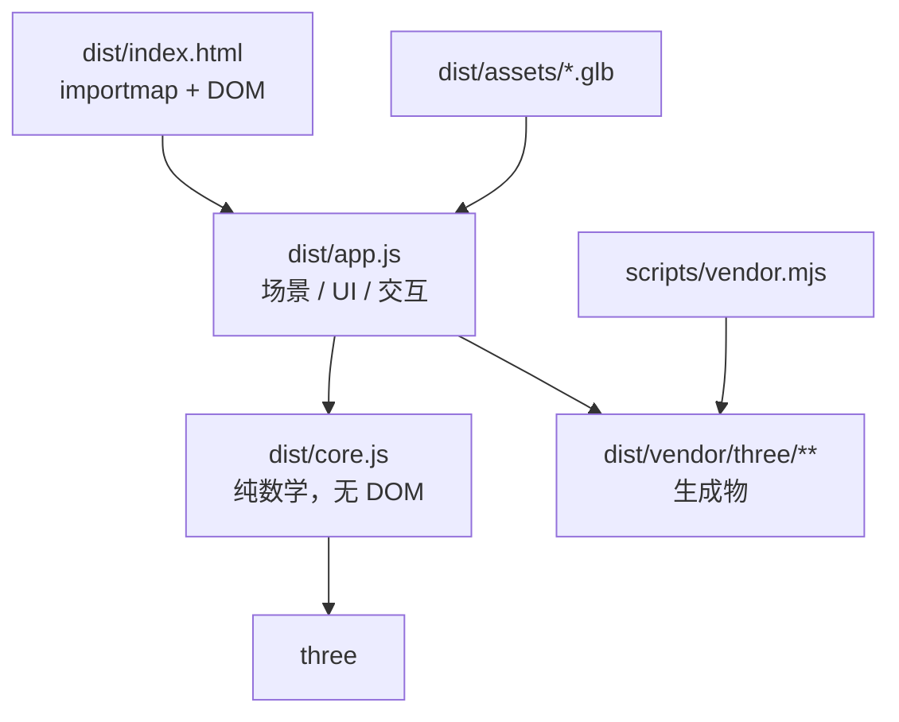
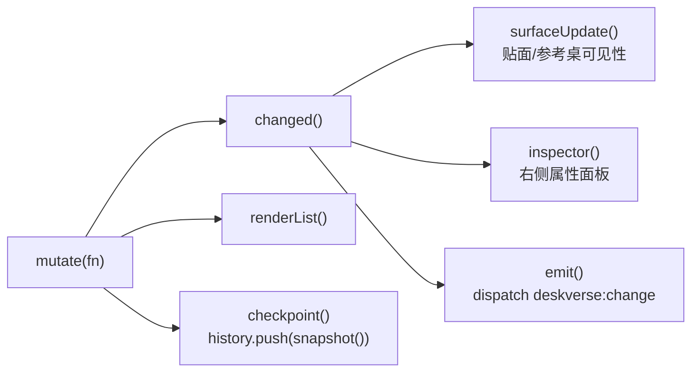

# Repository Guidelines

DeskVerse Studio：浏览器端三维桌面摆放工作台。基础摆放无后端、无 CDN、无构建步骤；照片建模使用 Python 本机 Rodin 代理。团队分工「三」的交付物。

**最重要的一点：`dist/` 不是构建产物目录，它同时是源码目录和交付物目录。** 没有 bundler、没有 `npm run build`。浏览器通过 `dist/index.html` 里的 importmap 直接解析裸模块名。

## Project Overview

用途：导入 `.glb` 模型 → 在网页中移动/旋转/缩放 → 输入真实尺寸校准 → 摆放并贴合桌面 → 导出布局 JSON。

- 场景摆放和尺寸图 OCR 在本机处理；照片建模只在用户确认后上传所选照片到 Rodin，并消耗账户 API credits。场景刷新即清空，本机生成任务与 GLB 保存在被忽略的 `.deskverse/`。
- 离线可用：Three.js r180 与 Draco / Meshopt / KTX2 解码器已 vendored 进 `dist/vendor/three/`；Tesseract.js worker、LSTM 核心和简体中文模型位于 `dist/vendor/ocr/`。
- 对外契约是 `window.deskverse`（供队友「4 号」做越界/重叠判断接入），见 `README.md` 的「给 4 号同学的接口」。

## Git Collaboration Workflow

本节适用于所有成员及代为修改仓库的自动化助手。`main` 是稳定交付分支；所有功能、修复、文档与配置变更都通过独立分支和 Pull Request（PR）合入，**禁止直接在 `main` 上开发、提交或推送**。

### 任务与分支

- 开工前在 Issue 或团队任务记录中明确负责人、改动范围与验收标准；同一任务由一人负责集成。涉及 `window.deskverse`、导出数据结构或多人同时修改的文件时，先与相关成员确认接口和文件分工。
- **每人每个新功能创建一个新分支**；修复和文档任务也使用独立分支。一个分支只处理一个任务，不混入无关重构，不复用已合并分支。
- 分支命名：`<type>/<owner>-<short-description>`，使用小写英文与连字符；`type` 使用 `feat`、`fix`、`docs`、`refactor`、`test` 或 `chore`，例如 `feat/alice-object-snapping`、`docs/bob-collaboration-rules`。有关联 Issue 时可加入编号。
- 从最新的 `origin/main` 创建分支，而不是从过期的本地分支或队友未合并的功能分支创建。以下示例假定远端名为 `origin`；实际不同则替换，分支名也须替换为自己的任务名称。

```bash
# 确认工作区和暂存区干净；有改动时先按下节保护现场
git status
git fetch origin --prune
git switch -c feat/alice-object-snapping origin/main
```

### 提交前同步与冲突处理

- **开始开发、每次提交前、每次推送前以及请求合并前，都必须先拉取并同步远端最新改动**。先用 `git status` 确认当前分支和本地改动，再执行 `git fetch origin --prune`；仅 fetch 不代表已经把远端变更合入当前分支。
- 同步前必须保护未提交内容：有本任务改动时，可用 `git stash push -u -m 'before-sync: task description'` 暂存，记录对应条目；完成同步后用 `git stash apply <stash-ref>` 恢复，确认完整后再删除该条目。`-u` 不包含被忽略文件。发现其他成员或用户留下的改动时，先确认归属，不擅自暂存、提交、覆盖或清除。
- 当前任务分支已有同名远端分支及正确的 upstream 时，先执行 `git pull --ff-only` 同步该分支；若尚未设置 upstream，则明确合并已 fetch 的 `origin/<当前分支名>`。全新的分支没有远端对应分支时跳过这一步。
- 若 `pull --ff-only` 因双方都有新提交而失败，先检查双方提交并与分支参与者确认，再用 `git merge origin/<当前分支名>` 保留双方历史；不得用强推或硬重置绕过分歧。
- 随后在**当前任务分支**执行 `git merge origin/main`，吸收主分支最新改动。默认使用 merge 同步，避免改写已发布历史；多人共享或已推送的提交不得擅自 rebase、amend 或强推。
- 恢复暂存内容后重新检查差异。发生 merge 或 stash 恢复冲突时，逐段理解双方意图，与相关作者确认后解决；禁止不加判断地整文件选择 ours/theirs。移除冲突标记并验证受影响功能后，才可继续提交和推送。
- 网络、权限或冲突导致同步失败时，停止常规提交、推送及合并流程并报告具体阻塞；不能把“尝试拉取”当作“已完成同步”。

### 提交内容与提交信息

- 每次提交只表达一个完整、可说明的改动；按明确文件路径执行 `git add <path>`，提交前检查 `git diff --staged`。不得把队友改动、无关格式化或本机文件顺带提交。
- 提交标题使用英文，格式为 `type: concise summary`，需要范围时使用 `type(scope): concise summary`；类型与分支类型一致按变更性质选择，标题明确说明“改了什么”，不能只写 `update`、`fix bug` 或 `修改代码`。
- 示例：`feat: add object snapping to desk surface`、`fix(core): preserve horizontal position when placing models`、`docs: define Git collaboration workflow`。
- 非简单变更须在正文说明原因、关键行为变化、兼容性影响与验证结果；有关联 Issue 时引用编号。破坏性接口变更必须明确标注，并先与调用方协调迁移。
- 禁止提交密钥、令牌、个人配置、`node_modules/`、日志和临时文件。`dist/` 是源码和交付物，不能整体忽略；vendor 与示例资产只在相关任务中通过规定脚本更新。不要顺带重新生成或覆盖用户提供的真实 GLB。

### 推送、PR 与合并

- 提交只推送到自己的任务分支。首次推送使用 `git push -u origin <当前分支名>`；后续推送仍须核对目标分支，不得将目标设为 `main`。禁止 `git push --force`、`git push --mirror` 等可能覆盖他人历史的操作；`--force-with-lease` 也不是绕过审查的许可。
- 推送后创建以 `main` 为目标的 PR，写清任务或 Issue、变更摘要、影响范围、验证命令与实际结果；UI 变更附截图或操作记录，接口变更说明调用方迁移情况。未完成或尚未验证的工作使用 Draft PR。
- 请求审查前完成适用验证：代码改动按本文件要求先 `npm ci`，再运行 `npm test` 与 `node scripts/check-static.mjs`；UI 改动还必须通过 HTTP 服务在真实浏览器中操作验收。纯文档改动检查内容、命令与 Markdown，不要求安装依赖或运行无关测试。未执行的验证必须明确标注，不能声称通过。
- 至少一名非作者成员审查通过，所有阻塞意见解决、与最新 `main` 无冲突且适用检查通过后，由维护者合并。审查后新增实质性改动必须重新请求审查；同步或解决冲突后重新执行受影响的验证。
- 默认使用 Squash and merge，将一个任务整理为一个清晰提交；合并标题与正文遵守上述提交信息规范。需保留独立提交历史时，由维护者在 PR 中说明理由。
- 合并后关闭关联任务，确认无未合并工作再删除任务分支；下一个任务重新从最新 `origin/main` 建分支。已合入 `main` 的问题通过新的修复或 revert PR 处理，不重写主分支历史。

### 仓库保护与自动化边界

- 仓库管理员应为 `main` 配置分支保护或 ruleset：要求 PR、至少一名非作者批准、新提交使旧批准失效、解决所有审查讨论，并禁止强推和删除；已有 CI 时，将实际运行的检查设为必需检查。本文是协作约定，**不代表远端保护或 CI 已配置**。
- 自动化助手同样遵守分支、同步、审查和验证规则；修改文件不等于获准推送远端、合并 PR 或更改仓库保护设置，这些远端写操作须有用户明确授权。
- 不使用 `git reset --hard`、`git clean -fd`、强制切换分支等命令来“清理”不明改动。确需破坏性操作时，先说明影响范围、备份与恢复方式，并取得相关成员或用户确认。

## Architecture & Data Flow

两层，单向依赖：`index.html → app.js → core.js`。



- `core.js`：只 `import * as THREE from 'three'`。导出 `AXES`、`MAX_FILE_SIZE`、`inspectGLB`、`normalizeModel`、`boundsOf`、`placeOnSurface`、`getDimensions`、`setDimension`、`recordState`、`History`。**不含任何 DOM 访问**。
- `app.js`：拥有 renderer / scene / camera / OrbitControls / TransformControls / GLTFLoader，以及全部 UI 绑定。

**单一数据源：** 场景状态就是 `records: Map<id, record>` 里的 Three.js 对象本身，配合模块级 `activeIds` / `selectedId`。没有第二套位置数据。`record` 的 `root` 是包了两层的 `Group`——内层 `content` 承担「底部中心对齐原点」的偏移，外层 `root` 承担 position/rotation/scale。

**变更流（改任何东西都必须走这条链）：**



- `exportState()` 产出 `{schemaVersion:1, units:'cm', coordinateSystem, surface, objects[]}`，`objects` 每项由 `recordState()` 生成。这是 `getState()` 与 `deskverse:change` 的同一份 detail。
- 撤销/重做：`History` 把快照 `JSON.stringify` 后存字符串数组（默认上限 60）；`restore(state)` 反向写回 Three 对象并重建 `activeIds`。
- `checkpoint()` 受 `restoring` 标志保护，回放时不再入栈。

**坐标与单位约定（`core.js` 与 README 一致）：** 厘米、度、Y 轴向上、右手系、X 左右 / Z 前后；旋转序 `XYZ`；pivot 为「旋转前的底部中心」。`placeOnSurface(root, height)` 只平移 Y 使包围盒 `min.y === height`，不动 X/Z。`dimensionsCm` 是旋转前局部尺寸，**不等于**世界包围盒，也不等于底座占地。

## Key Directories

| 路径 | 用途 |
| --- | --- |
| `dist/` | 交付物 + 源码。`index.html` / `app.js` / `core.js` / `style.css` / `feature.css` 全部手写。 |
| `dist/assets/` | GLB。`demo-*.glb` 由脚本生成；`desk-real.glb`(41 MiB)、`monitor-real.glb`(28 MiB) 为用户提供，**不要**交给脚本覆盖。 |
| `dist/vendor/three/` | **生成物**，由 `scripts/vendor.mjs` 产出。禁止手改。 |
| `dist/vendor/ocr/` | **生成物**，由 `scripts/vendor-ocr.mjs` 产出。禁止手改。 |
| `scripts/` | Node ESM 开发工具，不在浏览器运行。 |
| `tests/` | `node:test` 用例，直接 import `../dist/core.js`。 |

## Development Commands

| 目的 | 命令 |
| --- | --- |
| 安装依赖（跑测试前必须） | `npm ci` |
| 跑 Node 测试（23 项） | `npm test` |
| 后端测试（23 项，模拟 Rodin） | `npm run test:server` |
| 静态校验：模块依赖、DOM id、必需文件 | `node scripts/check-static.mjs` |
| 重新生成 `dist/vendor/three/` | `npm run vendor` |
| 重新生成 `dist/vendor/ocr/` | `npm run vendor:ocr` |
| 重新生成示例 GLB | `node scripts/demo-assets.mjs` |
| 本地起服务 | `py start.py`（Windows）/ `python3 start.py` |
| Windows 一键启动 | 双击 `启动_Windows.bat` |

- 服务默认端口 **8000**。`start.py` 仅绑定 `127.0.0.1` 并自动开浏览器，支持 `--port 8002` 和 `--no-browser`。
- **千万不要双击 `dist/index.html`**：ES 模块与解码器需要 HTTP。
- `npm start` 调用 `python3 start.py`，带照片建模代理。普通静态服务只支持基础摆放和 OCR，不能调用照片生成接口。
- 运行交付物不需要 npm；只有跑测试或重生成 vendor 才需要 Node。

## Code Conventions & Common Patterns

**格式（重要，别「顺手美化」）：** `dist/core.js`、`dist/app.js` 是**一行多语句、零缩进**的紧凑风格；`dist/style.css` 是**整个文件一行**（约 58 KB）。`dist/feature.css` 和 `scripts/*.mjs` 才是常规多行缩进。改动时匹配所在文件的既有风格。

- 引号用单引号；语句带分号；无 TypeScript。
- 注释与面向用户的文案一律**中文**；`README.md` 也是中文。
- 命名：函数/变量 camelCase；高频缩写 `r` = record、`t` = table record、`n` = number。
- DOM 取用统一走 `const $=id=>document.getElementById(id)`。
- CSS 类名 kebab-case；状态类固定为 `active` / `invalid` / `confirmed`；语义色用 `dist/style.css` 的 `:root` 变量 `--ink --muted --line --accent --tint --bg --x --y --z`，坐标轴专用 `--x`(红) `--y`(绿) `--z`(蓝)。
- 数据驱动 DOM：`data-icon`（图标名）、`data-mode`（工具模式）、`data-distance`、`data-seat-distance`、`data-preset-size`；新增图标要同时改 `app.js` 顶部的 `iconPaths` 映射。
- 单位换算边界：`recordState()` 负责弧度→度（`MathUtils.radToDeg`），内部一律弧度。

**错误处理三档：** `throw new Error('中文提示')` 用于可恢复的输入错误（`core.js` 与 `setTransform` 都用这个，`setTransform` 里混有英文 `'Unknown object id'`）；`toast(msg)` 用于瞬时用户反馈（`mutate()` 与 `importFiles()` 会 catch 并 toast）；`fatal(msg)` 用于启动即失败（WebGL 不可用等）。批量导入逐个文件 try/catch，失败计数并在 `console.warn('GLB import failed', e)` 留痕。

**异步：** async/await。`importFiles()` 串行处理文件并驱动 `setBusy(true/false)`（统一禁用一组按钮）。`loader.parseAsync(buffer, '')` 解析内存 buffer，不走网络。

**资源上限：** 单文件 `MAX_FILE_SIZE` = 80 MiB；会话累计 240 MiB（`app.js` 里硬编码）；单文件超限直接 throw。

## Important Files

| 文件 | 说明 |
| --- | --- |
| `dist/index.html` | 入口。57 行。含 importmap（`three` → `./vendor/three/three.module.js`，`three/addons/` → `./vendor/three/addons/`）与全部 DOM；末尾有 `<script type="module" src="./app.js">`。 |
| `dist/app.js` | 入口逻辑。189 行。`window.deskverse` 在 **182-185 行**：`getState` / `select(id)` / `setTransform(id, patch)` / `importFiles`。末尾 `await loadRealScene()` 自动载入真实桌子显示器。 |
| `dist/core.js` | 纯函数层，58 行。改动这里必须同步 `tests/core.test.mjs`。 |
| `scripts/check-static.mjs` | 轻量静态守卫：解析模块图（含 importmap 别名）、校验 HTML id 唯一且 `app.js` 引用的 id 都存在，并断言 GLB、解码器与离线 OCR worker / WASM / 语言模型文件在位。 |
| `scripts/vendor.mjs` | 从 `node_modules/three` 复制 `three.module.js` / `three.core.js` / `LICENSE`，并递归抓取 addon 的相对 import 及 Draco / Basis 二进制。需要先 `npm ci`。 |
| `scripts/vendor-ocr.mjs` | 从 `node_modules/tesseract.js` 与 `tesseract.js-core` 复制 OCR worker / WASM 核心，并复制 `scripts/ocr/chi_sim.traineddata`，生成离线浏览器 OCR 资源。 |
| `README.md` | **对外契约文档**：`window.deskverse` 用法、`getState()` 字段表、吸附规则、资产边界。改公开 API 必须同步这里。 |
| `dist/generation.js` | 照片预览、扣费确认、任务轮询、刷新恢复、模型下载与场景导入；通过 `initPhotoGeneration` 的回调接入 `app.js`。 |
| `dist/drawers.js` | 命名桌板锚点校准、四抽屉轨道、延伸到开口边界的柜门铰链、椅子提取、世界内腔与保守收纳选位；无 DOM。右侧内盒是按柜体重建的可见几何，必须保留 UI 和导出的 estimated 标记，不能当作商家实测尺寸。 |
| `dist/collision.js` | Three.js OBB 部件重叠和路径提醒；无 DOM，只读，禁止回退或限制用户变换。`mode:warn`、`blocked:false`，地面和收纳尺寸同样只提醒。 |
| `dist/reference.js` | 类别参考尺寸、名称 / 外形估算朝向、规范化前模型包装、朝向修改和照片类别偏好；无 DOM。参考值不能标成实测校准；不能覆盖尺寸图 / 手工规格。 |
| `dist/app.js` 光照段 | 宿舍白天、窗边侧光、夜晚、暖色台灯、模型展示五组场景；通过环境强度、方向光、点光、背景和曝光模拟，不能改写 GLB 纹理。木质 PBR 材质只降低过强反光。 |
| `start.py` | 仅标准库的本机静态服务器与 API 路由，带 Host / Origin / CSRF 校验。不是公网多用户服务。 |
| `rodin_service.py` | 本机 Rodin 代理：读取环境变量或 `.env`，异步提交、查询、下载并保存任务至 `.deskverse/`。不自动重发状态不明的付费请求。禁止提交真实密钥和任务私密订阅信息。 |

## Runtime/Tooling Preferences

- **Node.js**（[INFERENCE] 18+，`package.json` 无 `engines` 字段）：仅开发/测试需要。测试脚本与 `scripts/` 用 **ESM**——`package.json` 有 `"type": "module"`，脚本扩展名为 `.mjs`。
- **包管理器：npm**。仓库只有 `package-lock.json`（lockfileVersion 3），无 pnpm/yarn 锁文件。依赖用**精确版本** `"three": "0.180.0"` 与 `"tesseract.js": "7.0.0"`，改版本必须同步 `package-lock.json`（用 `npm version` / `npm install`，别手改）。
- **Python 3.9+**：本机服务器、Rodin 代理及后端单测，只用标准库，可用 `py` 或 `python3`。
- **不存在的东西**（已确认全仓无匹配）：TypeScript / `tsconfig.json`、任何 bundler（vite/rollup/webpack）、ESLint / Prettier / Biome / `.editorconfig`、`.github/workflows`、Makefile、git hooks。**不要引入以上工具**，会与「无构建、浏览器直读源码」的架构冲突。
- `dist/vendor/three/`、`dist/vendor/ocr/` 与 `dist/assets/demo-*.glb` 是**生成物但必须提交**（`.gitignore` 顶部注释已声明：`dist/` 是已构建产物，必须保留在仓库里）。`node_modules/` 已被忽略。

## Testing & QA

- 框架：Node 内置 **`node:test` + `node:assert/strict`**，无第三方测试框架。`tests/core.test.mjs`、`tests/drawers.test.mjs`、`tests/collision.test.mjs`、`tests/reference.test.mjs` 覆盖核心、真实家具、只读碰撞提醒和参考尺寸 / 朝向。
- **跑测试前必须 `npm ci`**：用例 `import * as T from 'three'` 走裸模块名，没有 `node_modules` 会 `ERR_MODULE_NOT_FOUND`。
- 覆盖率范围：**只覆盖 `core.js`**。用例按 import 进来的 shipped 代码（`../dist/core.js`）测试，分组为：归一化与底部中心 pivot、任意旋转/非等比缩放后贴面、等比与分轴校准、商品规格的精确 XYZ 尺寸、尺寸图 OCR 文本解析、坐高估算、`recordState` 坐标语义、`locked` 透传、`History`、**真实二进制 GLB 加载**（读取 `dist/assets/demo-lamp|monitor|table.glb`）、损坏 GLB 与外部 `uri` 拒绝。
- Python 的 `tests/test_rodin_service.py` 使用标准库 `unittest`，覆盖异步提交、幂等、任务恢复、下载重试、凭据隔离和 HTTP 安全边界；测试中必须模拟上游，禁止消耗真实 API credits。
- `scripts/check-drawer-ui.mjs` 验证收纳、取出、超尺寸只提醒、自由移动、撤销重做和截图。`scripts/check-furniture-ui.mjs` 验证四抽屉、柜门、椅子、提醒不拦截和画面稳定性。默认场景是桌柜、椅子和显示器三个对象。
- `scripts/check-placement-ui.mjs` 验证自由变换、照片扶正、常见参考尺寸、朝向历史、尺寸图规格并存及手机布局。`PHOTO_MODEL_PATH` 可选已有本机 GLB，API 和 OCR 被模拟，不能将其当成真实新生成或 OCR 准确率验证。接口新增 `modelOrientation`、`referenceSize`；碰撞 `mode:warn`，不得恢复为强制拦截。
- `scripts/check-lighting-ui.mjs` 验证五种宿舍 / 模型展示光照、亮度、冷暖、导出状态和无页面错误；光照测试不上传照片、不生成模型。
- 门与抽屉交互规则：门的 `opening=0` 表示关闭、`opening=1` 表示打开；关门自动收回所有打开抽屉，开抽屉时若门关闭则自动开门。坐姿按钮必须是可重复点击的进入 / 退出切换；`view-top` 是约 240 cm 的斜上方桌面视角，右上角视角工具必须保留可见中文标签和 tooltip。
- 实体椅子前后滑杆必须读取事件值后再触发 `select` / `mutate`，避免重新渲染控制面板把正在拖动的值覆盖；范围固定为 -30 至 +120 cm，原位保存在 `chairHomeZ`。
- 新增用例约定：沿用 `near(actual, expected)`（容差 `1e-5`）做浮点断言；沿用 `record()` 工厂构造 `BoxGeometry(2,4,6)` + `normalizeModel(m, 60)` 得 20×40×60 的基准记录；标题用英文陈述句描述行为。
- 照片建模有 `scripts/check-photo-ui.mjs` 的 Chrome / Playwright 交互验收，默认模拟生成接口并保存桌面/移动端截图，禁止把模拟任务当作真实生成质量验证。其余摆放工具仍需人工浏览器验收；静态校验会检查自有模块中的 DOM ID 引用。
- 已知文档不一致，别照抄 README：README 提到的 `base_basic_pbr.glb` / `monitor_demo.glb` 是导入后的来源名，磁盘资产实际为 `desk-real.glb` / `monitor-real.glb`。
