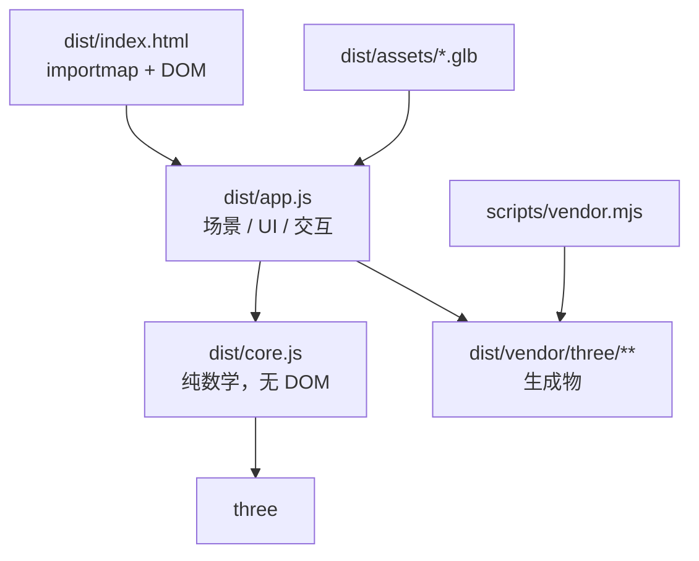
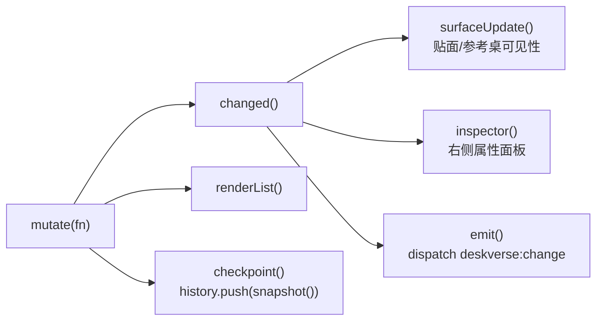

# Repository Guidelines

DeskVerse Studio：纯浏览器端三维桌面摆放工作台。无后端、无 CDN、无构建步骤。团队分工「三」的交付物。

**最重要的一点：`dist/` 不是构建产物目录，它同时是源码目录和交付物目录。** 没有 bundler、没有 `npm run build`。浏览器通过 `dist/index.html` 里的 importmap 直接解析裸模块名。

## Project Overview

用途：导入 `.glb` 模型 → 在网页中移动/旋转/缩放 → 输入真实尺寸校准 → 摆放并贴合桌面 → 导出布局 JSON。

- 场景数据全部在浏览器本机解析，不上传服务器；刷新即清空。
- 离线可用：Three.js r180 与 Draco / Meshopt / KTX2 解码器已 vendored 进 `dist/vendor/three/`。
- 对外契约是 `window.deskverse`（供队友「4 号」做越界/重叠判断接入），见 `README.md` 的「给 4 号同学的接口」。

## Architecture & Data Flow

两层，单向依赖：`index.html → app.js → core.js`。

- `core.js`：只 `import * as THREE from 'three'`。导出 `AXES`、`MAX_FILE_SIZE`、`inspectGLB`、`normalizeModel`、`boundsOf`、`placeOnSurface`、`getDimensions`、`setDimension`、`recordState`、`History`。**不含任何 DOM 访问**。
- `app.js`：拥有 renderer / scene / camera / OrbitControls / TransformControls / GLTFLoader，以及全部 UI 绑定。

**单一数据源：** 场景状态就是 `records: Map<id, record>` 里的 Three.js 对象本身，配合模块级 `activeIds` / `selectedId`。没有第二套位置数据。`record` 的 `root` 是包了两层的 `Group`——内层 `content` 承担「底部中心对齐原点」的偏移，外层 `root` 承担 position/rotation/scale。

**变更流（改任何东西都必须走这条链）：**

- `exportState()` 产出 `{schemaVersion:1, units:'cm', coordinateSystem, surface, objects[]}`，`objects` 每项由 `recordState()` 生成。这是 `getState()` 与 `deskverse:change` 的同一份 detail。
- 撤销/重做：`History` 把快照 `JSON.stringify` 后存字符串数组（默认上限 60）；`restore(state)` 反向写回 Three 对象并重建 `activeIds`。
- `checkpoint()` 受 `restoring` 标志保护，回放时不再入栈。

**坐标与单位约定（`core.js` 与 README 一致）：** 厘米、度、Y 轴向上、右手系、X 左右 / Z 前后；旋转序 `XYZ`；pivot 为「旋转前的底部中心」。`placeOnSurface(root, height)` 只平移 Y 使包围盒 `min.y === height`，不动 X/Z。`dimensionsCm` 是旋转前局部尺寸，**不等于**世界包围盒，也不等于底座占地。

## Key Directories

| 路径 | 用途 |
| --- | --- |
| `dist/` | 交付物 + 源码。`index.html` / `app.js` / `core.js` / `style.css` / `feature.css` 全部手写。 |
| `dist/assets/` | GLB。`demo-*.glb` 由脚本生成；`desk-real.glb`(41 MiB)、`monitor-real.glb`(28 MiB) 为用户提供，**不要**交给脚本覆盖。 |
| `dist/vendor/three/` | **生成物**，由 `scripts/vendor.mjs` 产出。禁止手改。 |
| `scripts/` | Node ESM 开发工具，不在浏览器运行。 |
| `tests/` | `node:test` 用例，直接 import `../dist/core.js`。 |

## Development Commands

| 目的 | 命令 |
| --- | --- |
| 安装依赖（跑测试前必须） | `npm ci` |
| 跑测试（13 项） | `npm test` |
| 静态校验：模块依赖、DOM id、必需文件 | `node scripts/check-static.mjs` |
| 重新生成 `dist/vendor/three/` | `npm run vendor` |
| 重新生成示例 GLB | `node scripts/demo-assets.mjs` |
| 本地起服务 | `py start.py`（Windows）/ `python3 start.py` |
| Windows 一键启动 | 双击 `启动_Windows.bat` |

- 服务固定端口 **8000**。`start.py` 仅绑定 `127.0.0.1` 并自动开浏览器。
- **千万不要双击 `dist/index.html`**：ES 模块与解码器需要 HTTP。
- `npm start`（`python3 -m http.server 8000 --directory dist`）会绑到 `0.0.0.0`，对外暴露，[INFERENCE] 仅在本机使用时优先 `start.py`。
- 运行交付物不需要 npm；只有跑测试或重生成 vendor 才需要 Node。

## Code Conventions & Common Patterns

**格式（重要，别「顺手美化」）：** `dist/core.js`、`dist/app.js` 是**一行多语句、零缩进**的紧凑风格；`dist/style.css` 是**整个文件一行**（约 58 KB）。`dist/feature.css` 和 `scripts/*.mjs` 才是常规多行缩进。改动时匹配所在文件的既有风格。

- 引号用单引号；语句带分号；无 TypeScript。
- 注释与面向用户的文案一律**中文**；`README.md` 也是中文。
- 命名：函数/变量 camelCase；高频缩写 `r` = record、`t` = table record、`n` = number。
- DOM 取用统一走 `const $=id=>document.getElementById(id)`。
- CSS 类名 kebab-case；状态类固定为 `active` / `invalid` / `confirmed`；语义色用 `dist/style.css` 的 `:root` 变量 `--ink --muted --line --accent --tint --bg --x --y --z`，坐标轴专用 `--x`(红) `--y`(绿) `--z`(蓝)。
- 数据驱动 DOM：`data-icon`（图标名）、`data-mode`（工具模式）、`data-distance`、`data-preset-size`；新增图标要同时改 `app.js` 顶部的 `iconPaths` 映射。
- 单位换算边界：`recordState()` 负责弧度→度（`MathUtils.radToDeg`），内部一律弧度。

**错误处理三档：** `throw new Error('中文提示')` 用于可恢复的输入错误（`core.js` 与 `setTransform` 都用这个，`setTransform` 里混有英文 `'Unknown object id'`）；`toast(msg)` 用于瞬时用户反馈（`mutate()` 与 `importFiles()` 会 catch 并 toast）；`fatal(msg)` 用于启动即失败（WebGL 不可用等）。批量导入逐个文件 try/catch，失败计数并在 `console.warn('GLB import failed', e)` 留痕。

**异步：** async/await。`importFiles()` 串行处理文件并驱动 `setBusy(true/false)`（统一禁用一组按钮）。`loader.parseAsync(buffer, '')` 解析内存 buffer，不走网络。

**资源上限：** 单文件 `MAX_FILE_SIZE` = 80 MiB；会话累计 240 MiB（`app.js` 里硬编码）；单文件超限直接 throw。

## Important Files

| 文件 | 说明 |
| --- | --- |
| `dist/index.html` | 入口。57 行。含 importmap（`three` → `./vendor/three/three.module.js`，`three/addons/` → `./vendor/three/addons/`）与全部 DOM；末尾有 `<script type="module" src="./app.js">`。 |
| `dist/app.js` | 入口逻辑。189 行。`window.deskverse` 在 **182-185 行**：`getState` / `select(id)` / `setTransform(id, patch)` / `importFiles`。末尾 `await loadRealScene()` 自动载入真实桌子显示器。 |
| `dist/core.js` | 纯函数层，58 行。改动这里必须同步 `tests/core.test.mjs`。 |
| `scripts/check-static.mjs` | 轻量静态守卫：解析模块图（含 importmap 别名）、校验 HTML id 唯一且 `app.js` 引用的 id 都存在、断言 `feature.css` 与 `assets/desk-real.glb`、`assets/monitor-real.glb` 等文件在位。 |
| `scripts/vendor.mjs` | 从 `node_modules/three` 复制 `three.module.js` / `three.core.js` / `LICENSE`，并递归抓取 addon 的相对 import 及 Draco / Basis 二进制。需要先 `npm ci`。 |
| `README.md` | **对外契约文档**：`window.deskverse` 用法、`getState()` 字段表、吸附规则、资产边界。改公开 API 必须同步这里。 |
| `start.py` | 仅标准库的本地静态服务器（`ThreadingHTTPServer` + `SimpleHTTPRequestHandler`）。 |

## Runtime/Tooling Preferences

- **Node.js**（[INFERENCE] 18+，`package.json` 无 `engines` 字段）：仅开发/测试需要。测试脚本与 `scripts/` 用 **ESM**——`package.json` 有 `"type": "module"`，脚本扩展名为 `.mjs`。
- **包管理器：npm**。仓库只有 `package-lock.json`（lockfileVersion 3），无 pnpm/yarn 锁文件。依赖用**精确版本** `"three": "0.180.0"`，改版本必须同步 `package-lock.json`（用 `npm version` / `npm install`，别手改）。
- **Python 3**：仅 `start.py`，只用标准库，可用 `py` 或 `python3`。
- **不存在的东西**（已确认全仓无匹配）：TypeScript / `tsconfig.json`、任何 bundler（vite/rollup/webpack）、ESLint / Prettier / Biome / `.editorconfig`、`.github/workflows`、Makefile、git hooks。**不要引入以上工具**，会与「无构建、浏览器直读源码」的架构冲突。
- `dist/vendor/three/` 与 `dist/assets/demo-*.glb` 是**生成物但必须提交**（`.gitignore` 顶部注释已声明：`dist/` 是已构建产物，必须保留在仓库里）。`node_modules/` 已被忽略。

## Testing & QA

- 框架：Node 内置 **`node:test` + `node:assert/strict`**，无第三方测试库。单文件 `tests/core.test.mjs`，13 个用例。
- **跑测试前必须 `npm ci`**：用例 `import * as T from 'three'` 走裸模块名，没有 `node_modules` 会 `ERR_MODULE_NOT_FOUND`。
- 覆盖率范围：**只覆盖 `core.js`**。用例按 import 进来的 shipped 代码（`../dist/core.js`）测试，分组为：归一化与底部中心 pivot、任意旋转/非等比缩放后贴面、等比与分轴尺寸校准、非法尺寸与空几何拒绝、`recordState` 坐标语义、`locked` 透传、`History` 的 undo/redo 与上限、**真实二进制 GLB 加载**（读取 `dist/assets/demo-lamp|monitor|table.glb`）、损坏 GLB 与外部 `uri` 拒绝。
- 新增用例约定：沿用 `near(actual, expected)`（容差 `1e-5`）做浮点断言；沿用 `record()` 工厂构造 `BoxGeometry(2,4,6)` + `normalizeModel(m, 60)` 得 20×40×60 的基准记录；标题用英文陈述句描述行为。
- **`app.js` 的 DOM/UI/交互没有任何自动化测试。** 新增 UI 行为靠人工浏览器验收，`check-static.mjs` 只能守模块图与 id 引用。改动 UI 后必须真在浏览器里点一遍。
- 已知文档不一致，别照抄 README：README 写「12 项 Node 测试」（实际 13）；README 提到的 `base_basic_pbr.glb` / `monitor_demo.glb` 实际文件名为 `desk-real.glb` / `monitor-real.glb`。
