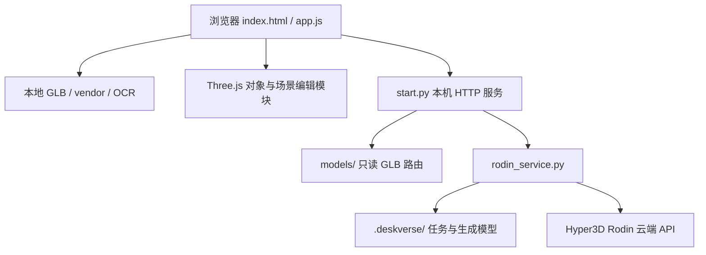
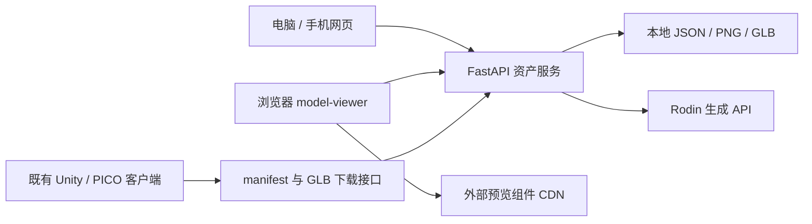

# DeskVerse Studio 技术文档

更新日期：2026-10-18

产品 A 实现基线：`10463f5`；`package.json` 版本 `1.5.0`。本文同时补充产品 B：DeskVerse Web Studio v1.4，代码依据指定目录 `../DeskVerse_Web_Studio_v14/DeskVerse_Web_Studio_v14`，独立交付于同仓库 `MRStudio` 分支。前九节描述产品 A，第十节描述产品 B，第十一节比较与交接。产品及原创边界见[项目说明文档](项目说明文档.md)，依赖授权见[第三方资源说明](第三方资源说明.md)。

## 一、技术选型与运行结构

- 前端：原生 HTML / CSS / JavaScript ES Modules、Three.js `0.180.0`（r180）。HTML importmap 将裸模块名映射至仓库本地文件，无 bundler、无构建步骤、无运行时 CDN。
- OCR：Tesseract.js `7.0.0`、Tesseract.js-core `7.0.0` 的 LSTM WASM 核心及本地简体中文训练数据，在浏览器 worker 中执行。
- 本机服务：Python 标准库实现 HTTP 静态服务、模型库路由及 Rodin 异步任务代理，无 Python 第三方依赖。
- 外部生成：使用 Hyper3D Rodin 云端 API；不是项目自研生成模型，也不以 MCP 作为当前应用的生成调用链。
- 存储：浏览器内存保存当前场景与 A/B 历史；少量界面偏好使用 `localStorage`；生成任务及 GLB 保存至本机 `.deskverse/`。无数据库、账号系统或场景云同步。



`dist/` 同时是手写源码和前端交付目录，不能作为构建缓存删除。完整资产库还依赖仓库根目录的 `models/`；只部署 `dist/` 并不等于部署了完整模型库或照片代理。

## 二、模块职责

| 路径 | 责任 |
| --- | --- |
| `dist/index.html`、`style.css`、`feature.css` 等 | DOM、三主题、布局与响应式面板 |
| `dist/app.js` | renderer / scene / camera、选择和工具、业务编排、事件、导入导出、家具与预览状态 |
| `dist/core.js` | GLB 检查、模型归一化、尺寸、贴面、对象状态及历史栈；不访问 DOM |
| `dist/reference.js` | 类别参考尺寸、模型预处理朝向、扶正和照片类别参考 |
| `dist/drawers.js` | 命名家具节点识别、四抽屉轨道、柜门铰链、椅子提取、世界内腔与收纳选位 |
| `dist/collision.js` | 按部件 OBB 的重叠、地面及运动路径提醒，不限制变换 |
| `dist/placement.js` | 桌板顶面边界环、保守 XZ 投影凸包、支撑范围与占地判断 |
| `dist/plan-view.js` | 二维图投影、绘制、选择、键盘与拖动交互 |
| `dist/workspaces.js` | A/B 快照及各自历史 |
| `dist/model-catalog.js`、`model-library.js` | 内置模型目录、参考尺寸、缩略图和会话自定义模型 |
| `dist/layout-import.js` | 布局格式校验、内置资源映射与旧来源标识识别 |
| `dist/desk-view.js`、`environment.js`、`asset-lights.js` | 桌柜线框、环境与预设布光、灯具局部发光 |
| `dist/render-export.js` | 出图相机、16:9 取景、临时隐藏辅助物及 PNG 导出 |
| `dist/generation.js` | 照片选择、上传 / 扣费确认、本次密钥配置、任务轮询和生成结果导入 |
| `dist/panel-resize.js` | 资产面板宽度与偏好 |
| `start.py`、`rodin_service.py` | 本机路由、安全检查、Rodin 请求 / 恢复 / 下载与持久化 |
| `scripts/vendor*.mjs` | 从锁定依赖整理浏览器资源和许可副本；不在用户浏览器执行 |
| `scripts/demo-assets.mjs` | 用几何与材质生成三份示例 GLB，不生成真实桌柜或商品模型 |

## 三、场景状态、坐标和编辑一致性

### 单一场景数据源

`app.js` 的 `records: Map` 保存对象记录，`activeIds` 指定当前方案可见对象，`selectedId` 指定选择。变换直接作用于记录内的 Three.js 对象，不维护另一套独立位置数据。根组承担位置 / 旋转 / 缩放，内容组承担归一化偏移；部分模型另有归一化前朝向修正包装。

普通业务编辑通过 `mutate()` / `changed()` 更新贴面、属性面板、二维状态和事件，并通过 `checkpoint()` 保存快照。拖动、家具动画及导入等路径在交互边界提交历史，避免每一帧都成为一个撤销步骤。`restore()` 在恢复标志保护下回放，不再重复压入历史。

### 坐标与尺寸

| 概念 | 约定 |
| --- | --- |
| 业务长度 | 厘米；应用中 1 单位按 1 cm 解释，导入后须归一化 / 校准 |
| 坐标 | 右手系；Y 向上，X 左右，Z 前后；向量为 `[X,Y,Z]` |
| 旋转 | 内部弧度；公共状态与布局使用度，Euler 顺序 `XYZ` |
| pivot | 旋转前底部中心；不等同于当前世界包围盒中心 |
| `dimensionsCm` | 旋转前局部尺寸 `[宽X,高Y,深Z]`，不是底座占地或旋转后的世界包围盒 |
| `worldBoundsCm` | 当前姿态下世界轴对齐包围盒 `min/max` |
| `placeOnSurface` | 仅沿 Y 平移，使世界包围盒底部落在给定表面，不改变 X/Z |
| 估算标记 | 类别参考与右侧重建抽屉内腔保留 `estimated`，不冒充实测 |

默认桌板作为世界 Y=0 的工作面，地面为 Y=-76 cm。桌柜床框标称 200×90 cm、总高 210 cm 是当前配置，不代表整套模型所有外伸部分的包围盒，更不是所有学校的宿舍规格。桌面边界取实际可信顶面几何，不能用整柜尺寸或参考矩形代替。

### A/B 与撤销

`Workspaces` 为 A、B 保存独立快照与 `History`；B 首次打开复制当前场景，之后相互独立。每套最多 60 条历史，使用序列化快照去重和回放；记录涉及的模型仍可能被历史引用。

物品、家具开合、收纳、规格与尺寸图会话状态按方案隔离；相机、主题、光照共享。加载、拖动等未结束时不切换方案。刷新清空场景、会话自定义库和历史，主题等偏好不能替代布局备份。

## 四、GLB、模型库与恢复流程

### GLB 导入

1. 检查单文件 80 MiB 上限、GLB 头、版本和 JSON 块等；拒绝外部 URI 资源引用。
2. `GLTFLoader.parseAsync` 解析内存字节；Draco、Meshopt、KTX2 路径均指向本地 vendor。
3. 根据角色与来源应用朝向、归一化和参考尺寸；参考缩放不自动证明实物已校准。
4. 生成对象记录；内置家具可识别并提取独立椅子，灯具附加局部光效；加入当前方案并更新状态。

只接收支持的嵌入资源 glTF 2.0 GLB，不把任意 `.gltf`、外部纹理或骨骼动画播放视作已支持功能。无场景累计 GLB 字节硬上限；界面显示当前方案引用文件总量，不是解码后内存或显存。高面数、大贴图、多灯具、历史和 A/B 都会增加资源开销。

### 模型库

`model-catalog.js` 声明内置资产和参考配置；缩略图来自模型实际离屏渲染，不是商品图片。普通卡片可创建多个实例，固定桌柜通过专门替换入口处理。自定义 GLB 和照片结果进入本次会话的自定义库，刷新后须重新提供原文件。

替换桌子先准备新几何及机构，再切换当前方案；失败保留原桌。成功后保留其他独立物品，解除旧抽屉关系，依贴面状态处理高度，支持撤销。家具机构识别依赖当前模型的命名和几何，不保证任意照片生成桌子都具有可操作抽屉。

### 布局 JSON

公共 `getState()` 返回编辑状态；下载的布局 JSON 在此基础上补充模型表及规格信息，两者不能完全等同。

| 字段 | 保存内容 |
| --- | --- |
| `schemaVersion` / `units` | `1` / `cm` |
| `layoutFormat` | 当前下载格式为 `named-models` |
| `coordinateSystem` | 轴、手性、旋转单位 / 顺序、pivot |
| `workspace` | 导出时方案标识；导入仍作用于当时的当前方案 |
| `models` | 以资源 key 为键的对象；每项含 `modelName`、`sourceFile`、`role`、`builtin`、`options`，不内嵌 GLB |
| `objects[]` | 对象变换、尺寸与校准、朝向、贴面 / 收纳、`modelKey`、`modelPart`、商品规格及当前规格选择 |
| `drawers[]` / `doors[]` | 家具开合及机构状态 |
| `appearance` / `view` / `lighting` | 主题、相机和光照预览状态 |
| `placement` / `collision` | 导出时的几何辅助状态；不是永久的安全证明 |

导入时校验格式、坐标约定、数值、ID、单桌限制和资源引用；优先按名称匹配库内模型，缺少自定义资产时要求同次选择原始 GLB。名称匹配不是内容真实性认证，用户须核对所提供文件。资源全部准备成功后才替换当前方案，另一方案不受影响；缺失或损坏文件不会先清空当前场景。

旧内嵌 Base64 模型布局会被拒绝；部分旧来源标识可识别，但不等于兼容全部历史文件。JSON 不包含撤销历史、尺寸图原图或模型字节；交接时须分别保存 A/B JSON 及自定义原始 GLB。

## 五、几何检查与家具适配

- **部件碰撞**：`collision.js` 按 mesh 部件使用 OBB，并对运动路径进行近似采样 / 扫掠提醒；它不是三角面精确接触或刚体动力学。结果明确为 `mode:'warn'`、`blocked:false`，检测到问题仍保留变换。
- **桌面范围**：`placement.js` 从可信水平顶面提取边界环，保留凹口、孔洞和分离区域；取不到可信几何时采用明确标记的估算。完整轮廓用 `rings` 和 even-odd 规则解释，`polygon` 仅保留最大面积环，`min/max` 仅为外接范围。
- **物品占地**：采用保守 XZ 投影凸包。凹形物品、空腔或悬挑可能误报；垂直完全分离及仅边界接触不算占地冲突。边界、尺寸和冲突各自给出 `ok` / `warning` / `na`，未知高度 / 未校准不能自动当作安全。
- **家具**：左抽屉沿 +Z，右侧三抽屉沿 -X；柜门旋转，关门先收回抽屉，拉抽屉自动开门。右抽屉托盘是运行时重建的估算内盒。收纳对象跟随所属抽屉；手动移出内腔可解除关系。
- **能力边界**：不计算承重、电气安全、安装 / 线缆余量、法规合规或精确人体工学。坐姿眼高属于估算；床垫虽可贴合可识别上铺，当前支撑检查仍可能提示未知高度。

## 六、照片建模、本机接口与安全边界

### 实际调用链

浏览器 `generation.js` → 同源 `start.py` → `rodin_service.py` → `https://api.hyper3d.com/api/v2/`。付费提交使用 multipart，多张 `images` 表示同一物品的多个视角。

产品 A 明确发送：`tier=Regular`、`geometry_file_format=glb`、`material=PBR`、`quality=medium`、`condition_mode=concat`。此接口路径含 `v2`，不能仅凭路径判断生成模型代际；官方 Gen-1/1.5 文档包含当前 Regular / concat 配置的说明。产品 B 的 Gen-2.5 参数另见第十节，两者不混用。

| 本机接口 | 用途 |
| --- | --- |
| `GET /api/generation/config` | 配置状态与 CSRF token，不返回 Key |
| `POST /api/generation/config` | `{apiKey}`，设置或替换本次服务进程密钥 |
| `GET /api/generation/jobs` | 查询本机历史任务 |
| `POST /api/generation/jobs` | 提交 `images` 数组（原始图片 Base64，非 data URL）、任务 ID / 名称等；需显式上传与扣费确认 |
| `GET /api/generation/jobs/<id>` | 刷新指定任务状态 |
| `GET /api/generation/models/<id>.glb` | 取得本机已下载结果 |

照片限制：PNG / JPG / WebP，同组 1–5 张；单张不超过 20 MiB，合计不超过 40 MiB。照片内容及顺序参与指纹，重复进行中 / 已完成任务可复用。提交结果不明进入 `uncertain`，不自动重发付费请求；后续查询或下载失败不应被解释为需要重新生成。

任务状态包含 `submitting`、`queued`、`generating`、`downloading`、`ready`、`failed`、`uncertain`。任务 JSON 和下载结果保存在 `.deskverse/`，浏览器可恢复任务列表，但这不恢复完整编辑场景。真实上游生成速度、质量和当前账户余额不由本次文档核查证明。

### 安全与数据处理

- 服务仅监听 `127.0.0.1`；检查 Host 和 Origin，写请求校验 CSRF token。
- 静态根为 `dist/`；`/models/` 仅提供 `models/` 内的 GLB，限制目录逃逸、符号链接越界和非 GLB 访问。
- Key 优先从环境变量读取，其次为根目录 `.env`；网页本次设置覆盖进程中的启动配置，不写入浏览器存储或磁盘。已有进行中任务时限制切换密钥。
- Key 与私密任务订阅信息不返回浏览器；下载外部 GLB 时不向下载地址转发 API Key，并限制协议、内网目标和重定向等。
- 普通模型、OCR 尺寸图和布局编辑不上传至 Rodin；经用户确认的生成照片会上传，第三方保存与使用政策另按官方条款核对。
- 以上是单机安全边界，不是公网鉴权、租户隔离、安全审计或隐私合规认证。`.env`、任务凭据、生成私有资产不能随比赛包无差别发布。

## 七、相机、出图和保存

自由 / 线框使用透视相机，俯视使用正交相机；右键平移同步移动相机和观察点，不修改模型。坐姿视角依据实体椅子及身高 / 坐高估算，不是头显追踪或 MR。

出图使用同一场景及光照；默认沿用当前视角，也可选预设构图。输出为 16:9：1920×1080、2560×1440、3840×2160。导出暂时隐藏选择框、手柄、网格等辅助物，线框桌柜恢复原材质，结束后恢复编辑现场。PNG 只包含画面，不包含可编辑资产。设备无法支持指定尺寸时应提示失败，不能将效果图当作物理光照或材质测量。

## 八、部署、开发与验证方式

### 运行交付物

仓库根目录运行 Windows `py start.py` 或 macOS / Linux `python3 start.py`；参数 `--port 8002 --no-browser` 可改变端口并禁用自动开浏览器。使用 HTTP，不支持 `file://` 直开。基础摆放和本地 OCR 不需要 Key 或联网；首次取得完整交付文件、配置 Key 和照片云端建模另行处理。

如部署普通静态站点，需要同时保留 `dist/vendor/`、`dist/assets/`，并正确映射 `/models/` 到允许公开的 GLB。该静态部署不提供照片生成；当前本机代理不能未经改造直接暴露为公共服务。

### 开发检查命令（不是本次已运行的测试成绩）

```bash
npm ci
npm test
node scripts/check-static.mjs
```

后端测试：Windows 用 `py -B -m unittest discover -s tests -p 'test_*.py'`；提供 `python3` 的环境可运行 `npm run test:server`。

Node 测试覆盖尺寸 / 历史、GLB、家具、碰撞 / 摆放、参考朝向、A/B、布局和出图等。Python 测试模拟 Rodin 上游并覆盖本机代理、安全边界与恢复，不应消耗真实生成额度。浏览器验收脚本位于 `scripts/check-*-ui.mjs`，需要另外可用的隔离 Playwright / Chrome 环境；部分脚本使用 pngjs，它们不是页面运行依赖。

本次是文档变更，执行文档本地链接、资源清单与 OCR 哈希核对，不重跑全部代码 / UI 测试，不将 README 的历史测试数量冒充本次结果。模拟生成与模拟 OCR 的验收不能证明真实 Rodin 质量或 OCR 准确率；真实硬件表现仍需赛前演示核验。

## 九、官方参考与实现定位

官方资料访问日期：2026-10-18。官网可能更新，项目运行版本仍以锁文件及本地 r180 为准。

- [Three.js GLTFLoader](https://threejs.org/docs/pages/GLTFLoader.html)：GLB / glTF 加载及 Draco、KTX2、Meshopt 解码器集成概念；固定版本可核对 [r180 GLTFLoader 源码](https://github.com/mrdoob/three.js/blob/r180/examples/jsm/loaders/GLTFLoader.js)。
- [Tesseract.js 官方项目](https://github.com/naptha/tesseract.js)与 [tessdata_fast 官方说明](https://github.com/tesseract-ocr/tessdata_fast)：浏览器 OCR 与 LSTM 数据；实际 worker 参数见 `dist/app.js`。
- [Rodin Gen-1/1.5 API](https://docs.hyper3d.ai/en/api-specification/rodin-gen1-1-5)：1–5 图、Regular 档与 concat 模式；不使用官方当前价格代替账户实际账单。
- 本仓库证据入口：[核心](../dist/core.js)、[主场景](../dist/app.js)、[布局验证](../dist/layout-import.js)、[模型目录](../dist/model-catalog.js)、[摆放](../dist/placement.js)、[碰撞](../dist/collision.js)、[服务](../start.py)、[Rodin 代理](../rodin_service.py)、[锁文件](../package-lock.json)。

## 十、产品 B：Web Studio v1.4 与 MR 资产接口

### 10.1 交付结构与职责

产品 B 的[MRStudio 分支](https://github.com/Remedy-Yang/DeskVerse/tree/MRStudio)具有独立根提交，须单独获取；不能把它当作产品 A 的增量代码覆盖当前目录。其网页显示 `v1.4`，后端 `FastAPI(..., version='0.9')` 与 `/health` 的 `Stage9` 是兼容旧接口的元信息，不代表网页版本仍为 0.9。

| 文件 / 模块 | 职责 |
| --- | --- |
| `backend/app.py` | FastAPI 路由、JSON 清单、图片 / GLB 存储、URL 取图及单线程 Rodin 任务 |
| `backend/web/index.html` | 工作台、资产库、三类导入表单、预览弹窗；动态加载 model-viewer |
| `backend/web/app.js` | 统计、搜索 / 分类 / 排序、上传、删除、任务查询与预览 |
| `backend/web/style.css` | 温馨简约主题、电脑 / 手机自适应与系统字体 |
| `backend/requirements.txt` | FastAPI、Uvicorn、python-multipart、requests、Pillow 的范围约束，无精确锁文件 |
| `install_to_existing_backend.ps1` | 备份并替换旧后端的一份 Python 与三份网页文件，不搬迁 data / 虚拟环境 / Unity 工程 |
| `tests/test_backend.py`、`test_rodin_stage10.py`、`test_studio.py`、`test_url_mode.py` | GLB / 图片、模拟 Rodin、管理与 URL 导入契约用例 |



图中的 PICO 客户端是外部集成前提，该目录没有 Unity 工程、C# 抓取脚本或 APK。README 描述使用现有 `RuntimeCatalogManager` / glTFast，保留 Video Seethrough XR Origin、`TableManager`、`MultiObjectManager` 并完成三点标定后加载资产；这些属于客户端操作说明，本轮不据此声称已复测手势、标定精度或头显碰撞。

### 10.2 接口与资产契约

| 方法 / 路径 | 行为 |
| --- | --- |
| `GET /health`、`GET /` | 健康状态与网页入口 |
| `GET /web/{filename}` | 仅允许 `style.css`、`app.js` |
| `GET /api/manifest` | `{version, assets[]}`；无清单文件时为版本 0、空资产数组 |
| `GET /api/glb/{asset_id}` | 下载对应 GLB；读取接口校验 32 位小写十六进制 ID |
| `POST /api/assets` | multipart GLB、名称和三项厘米尺寸；成功 201 并增加清单版本 |
| `DELETE /api/assets/{asset_id}` | 更新清单并永久删除服务器 GLB；已加载的头显对象需重启应用清除 |
| `GET /api/sources`、`POST /api/sources` | 列出或上传待生成图片源；保存图片不触发生成 |
| `GET /api/source-image/{source_id}` | 读取图片源 PNG |
| `POST /api/sources/from-url` | JSON 图片 / 商品页 URL、名称和尺寸，取图后写入待生成区 |
| `DELETE /api/sources/{source_id}` | 删除图片源与 PNG；存在非终态任务时返回 409 |
| `POST /api/generate` | `{source_id}`，创建 / 复用进行中任务；成功 202，无 Key 时 503 |
| `GET /api/tasks` | 本进程任务，按创建时间倒序，最多 100 项 |
| `GET /api/tasks/{task_id}` | 任务状态；重启后丢失的任务返回 404 |

GLB 资产包含 `id`、`name`、`createdAt`、相对下载地址 `url`、`widthMeters`、`depthMeters`、`visibleWidthMeters`；生成资产另有 `sourceId`、`imageUrl`。三项表单输入为 `width_cm`、`depth_cm`、`visible_width_cm`，分别表示占地宽、占地深和模型外观宽，范围均为 1–500 cm；存储时除以 100，保留五位小数。

这是**尺寸元数据契约**：后端不按这些字段改写 GLB 网格，不记录高度，也没有产品 A 的三轴校准、世界变换或布局 JSON。页面提示的按外观宽度缩放须由既有客户端消费，不能把它写成后端已完成几何缩放。

GLB 上限 40 MiB，检查 GLB v2 文件头及长度；与产品 A 的完整 JSON / 外部资源检查不是同一强度。图片上限 10 MiB，宽高各 64–4096 px，转为 RGB PNG；文件上传路径还检查不超过 1600 万像素。URL 取图限制公开 HTTPS、无账号密码、端口缺省或 443、公网解析地址、不跟随重定向；HTML 仅解析公开 `og:image` / Twitter 图片元数据，不执行页面 JavaScript，不绕过电商登录或平台授权。

### 10.3 Rodin 任务、持久化与预览

生成使用单张已保存图片，向 `https://api.hyper3d.com/api/v2/rodin` 发送 `tier=Gen-2.5-Medium`、`mesh_mode=Raw`、`quality=medium`；随后 `/status` 轮询、`/download` 取首个 GLB。代码按结果列表选择 GLB，没有显式发送产品 A 的 `geometry_file_format=glb` / `material=PBR` 参数。具体账户是否支持该档位需真实演示确认。

`ThreadPoolExecutor(max_workers=1)` 串行处理，状态为 `queued → submitting → generating → downloading → ready`，异常进入 `failed`。同一 source 的非终态任务重复提交可复用；ready / failed 后再次点击可创建新生成。总轮询期限 20 分钟，429 / 5xx 使用延迟重试，**包含提交请求的重试**，不具备产品 A 的 `uncertain` 持久化防重发语义；付费提交失败时应先核对上游任务，避免连续重试产生额外费用。

数据根可通过 `DESKVERSE_DATA_DIR` 指定，默认 `backend/data/`：`catalog.json` 存模型、`sources.json` 存图片源，`assets/` 存 GLB，`images/` 存 PNG。清单临时写入后原子替换；任务字典仅在内存，重启不恢复生成任务，但已保存资产和图片仍可读取。仓库不交付运行数据，首次克隆的资产库初始为空。

浏览器预览采用 `<model-viewer>`，先从 jsDelivr 加载 `@google/model-viewer@4.3.1`，失败再尝试 cdnjs `4.0.0`。控件支持旋转、缩放、自动旋转和 GLB 下载；CDN 阻断会影响预览，不等于资产上传 / API 停止。这里的浏览器预览不是 WebXR 或头显手势实现。

### 10.4 独立启动与演示条件

先单独克隆 `MRStudio` 分支，在该产品根目录创建隔离环境；Windows 示例：

```powershell
git clone --single-branch --branch MRStudio https://github.com/Remedy-Yang/DeskVerse.git DeskVerse-Web-Studio-v14
cd DeskVerse-Web-Studio-v14
py -m venv .venv
.\.venv\Scripts\python.exe -m pip install -r backend/requirements.txt
.\.venv\Scripts\python.exe -m uvicorn app:app --app-dir backend --host 0.0.0.0 --port 8001
```

8001 是与产品 A 默认 8000 同机演示时的避让示例，原 README 默认也是 8000。服务需要 `RODIN_API_KEY` 环境变量，不会自动读取产品 A 的 `.env` 或网页临时 Key。首装须联网安装依赖；预览 CDN、公开 URL 取图与 Rodin 也需联网。

本机访问 `http://127.0.0.1:8001`，手机和头显使用 `http://电脑局域网IPv4:8001`，并把既有客户端的服务地址 / 端口同步设置；设备端不能使用自己的 `127.0.0.1`。若升级旧 Stage12 后端，可按安装脚本备份替换代码，但不得覆盖其 `data/`。应用服务不提供账号鉴权和租户隔离，仅用于可信局域网，不应开放公网端口；产品 A 的 Host / Origin / CSRF 防护不自动适用于产品 B。

头显演示仍需现有 Unity/PICO 工程、对应 APK、标定与设备配置。README 中 HTTP 下载设置只适用于受信任局域网开发；网页新增 GLB 不等于构建或安装了新的头显应用。

### 10.5 本轮验证范围

本轮只读核对了四份测试文件及实现，不将其 README 的历史“12 项通过”作为本次成绩。当前可用解释器缺少 `python-multipart`，未安装依赖、启动完整 FastAPI 或调用付费 Rodin；没有读取 / 修改运行数据。

在不加载整个服务的情况下执行了原源码中的 URL 校验与 OpenGraph 解析函数：接受公网 HTTPS，拒绝 HTTP、本机地址和非标准端口，正确提取 `og:image`。这是局部函数烟测，不是完整 HTTP、浏览器、PICO 或真实生成验收。

## 十一、两套产品差异与资产交接

| 契约 | 产品 A：三维桌搭 | 产品 B：Web Studio v1.4 |
| --- | --- | --- |
| 核心定位 | 编辑、校准、检查与方案导出 | 资产收集、生成、管理与 MR 客户端供给 |
| 默认端口 / 网络 | 8000，仅本机 | 原默认 8000、可改 8001；可信局域网 |
| 服务实现 | Python 标准库 | FastAPI / Uvicorn 及第三方 Python 包 |
| GLB / 图片上限 | 80 MiB；建模单张 20 MiB、1–5 张合计 40 MiB | 40 MiB；单张 10 MiB |
| Rodin 提交 | Regular、PBR、GLB、concat 多视角 | Gen-2.5-Medium、Raw、单图 |
| 生成恢复 | 磁盘任务与 uncertain 状态，不自动重发不明付费提交 | 内存任务，重启不恢复；429 / 5xx 可重试提交 |
| 单位与持久化 | 厘米场景；手动保存布局，生成任务保存本机 | 厘米输入 / 米制资产元数据；图片与 GLB 清单落盘 |
| 浏览器依赖 | 本地 Three.js / OCR，无运行时 CDN | 预览依赖 model-viewer CDN |
| 头显接入 | 无 PICO / WebXR 客户端 | 已提供资产接口，依赖外部既有 Unity/PICO 客户端 |

当前明确可用的交接媒介是 GLB：产品 B 下载 → 产品 A 本地导入；反向可将保留的原始 GLB 上传到 B。两者的资产名称、尺寸语义、坐标与布局格式不自动转换，A 导出的布局 JSON 不是 B 的 manifest，不能直接互换。模型几何外观可复用，实际尺寸和摆放仍在目标端核对。

产品 B 证据：`backend/app.py:18–152`（资产契约）、`:167–253`（图片）、`:266–407`（生成）、`:424–551`（URL / 管理），`backend/web/index.html:10–17`（CDN），及该分支 README / 安装脚本。官方资料：[FastAPI](https://fastapi.tiangolo.com/)、[model-viewer](https://modelviewer.dev/docs/index.html)、[Rodin](https://docs.hyper3d.ai/zh/get-started/quick-start)。
