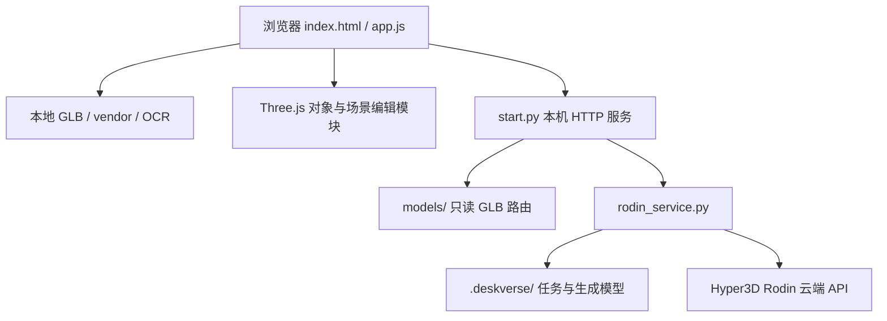
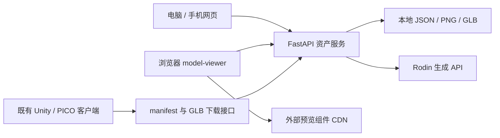

# DeskVerse Studio 技术文档与第三方资源说明

更新日期：2026-10-18

产品 A 实现基线：`10463f5`；`package.json` 版本 `1.5.0`。本文同时补充产品 B：DeskVerse Web Studio v1.4，代码依据指定目录 `../DeskVerse_Web_Studio_v14/DeskVerse_Web_Studio_v14`，独立交付于同仓库 `MRStudio` 分支。前九节描述产品 A，第十节描述产品 B，第十一节比较与交接，第十二节集中说明第三方资源与授权。产品及原创边界见[项目说明文档](项目说明文档.md)，依赖授权见[第三方资源与授权说明](#third-party-resources)。

## 一、技术选型与运行结构

- 前端：原生 HTML / CSS / JavaScript ES Modules、Three.js `0.180.0`（r180）。HTML importmap 将裸模块名映射至仓库本地文件，无 bundler、无构建步骤、无运行时 CDN。
- OCR：Tesseract.js `7.0.0`、Tesseract.js-core `7.0.0` 的 LSTM WASM 核心及本地简体中文训练数据，在浏览器 worker 中执行。
- 本机服务：Python 标准库实现 HTTP 静态服务、模型库路由及 Rodin 异步任务代理，无 Python 第三方依赖。
- 外部生成：使用 Hyper3D Rodin 云端 API；不是项目自研生成模型，也不以 MCP 作为当前应用的生成调用链。
- 存储：浏览器内存保存当前场景与 A/B 历史；少量界面偏好使用 `localStorage`；生成任务及 GLB 保存至本机 `.deskverse/`。无数据库、账号系统或场景云同步。



`dist/` 同时是手写源码和前端交付目录，不能作为构建缓存删除。完整资产库还依赖仓库根目录的 `models/`；只部署 `dist/` 并不等于部署了完整模型库或照片代理。

## 二、模块职责

| 路径 | 责任 |
| --- | --- |
| `dist/index.html`、`style.css`、`feature.css` 等 | DOM、三主题、布局与响应式面板 |
| `dist/app.js` | renderer / scene / camera、选择和工具、业务编排、事件、导入导出、家具与预览状态 |
| `dist/core.js` | GLB 检查、模型归一化、尺寸、贴面、对象状态及历史栈；不访问 DOM |
| `dist/reference.js` | 类别参考尺寸、模型预处理朝向、扶正和照片类别参考 |
| `dist/drawers.js` | 命名家具节点识别、四抽屉轨道、柜门铰链、椅子提取、世界内腔与收纳选位 |
| `dist/collision.js` | 按部件 OBB 的重叠、地面及运动路径提醒，不限制变换 |
| `dist/placement.js` | 桌板顶面边界环、保守 XZ 投影凸包、支撑范围与占地判断 |
| `dist/plan-view.js` | 二维图投影、绘制、选择、键盘与拖动交互 |
| `dist/workspaces.js` | A/B 快照及各自历史 |
| `dist/model-catalog.js`、`model-library.js` | 内置模型目录、参考尺寸、缩略图和会话自定义模型 |
| `dist/layout-import.js` | 布局格式校验、内置资源映射与旧来源标识识别 |
| `dist/desk-view.js`、`environment.js`、`asset-lights.js` | 桌柜线框、环境与预设布光、灯具局部发光 |
| `dist/render-export.js` | 出图相机、16:9 取景、临时隐藏辅助物及 PNG 导出 |
| `dist/generation.js` | 照片选择、上传 / 扣费确认、本次密钥配置、任务轮询和生成结果导入 |
| `dist/panel-resize.js` | 资产面板宽度与偏好 |
| `start.py`、`rodin_service.py` | 本机路由、安全检查、Rodin 请求 / 恢复 / 下载与持久化 |
| `scripts/vendor*.mjs` | 从锁定依赖整理浏览器资源和许可副本；不在用户浏览器执行 |
| `scripts/demo-assets.mjs` | 用几何与材质生成三份示例 GLB，不生成真实桌柜或商品模型 |

## 三、场景状态、坐标和编辑一致性

### 单一场景数据源

`app.js` 的 `records: Map` 保存对象记录，`activeIds` 指定当前方案可见对象，`selectedId` 指定选择。变换直接作用于记录内的 Three.js 对象，不维护另一套独立位置数据。根组承担位置 / 旋转 / 缩放，内容组承担归一化偏移；部分模型另有归一化前朝向修正包装。

普通业务编辑通过 `mutate()` / `changed()` 更新贴面、属性面板、二维状态和事件，并通过 `checkpoint()` 保存快照。拖动、家具动画及导入等路径在交互边界提交历史，避免每一帧都成为一个撤销步骤。`restore()` 在恢复标志保护下回放，不再重复压入历史。

### 坐标与尺寸

| 概念 | 约定 |
| --- | --- |
| 业务长度 | 厘米；应用中 1 单位按 1 cm 解释，导入后须归一化 / 校准 |
| 坐标 | 右手系；Y 向上，X 左右，Z 前后；向量为 `[X,Y,Z]` |
| 旋转 | 内部弧度；公共状态与布局使用度，Euler 顺序 `XYZ` |
| pivot | 旋转前底部中心；不等同于当前世界包围盒中心 |
| `dimensionsCm` | 旋转前局部尺寸 `[宽X,高Y,深Z]`，不是底座占地或旋转后的世界包围盒 |
| `worldBoundsCm` | 当前姿态下世界轴对齐包围盒 `min/max` |
| `placeOnSurface` | 仅沿 Y 平移，使世界包围盒底部落在给定表面，不改变 X/Z |
| 估算标记 | 类别参考与右侧重建抽屉内腔保留 `estimated`，不冒充实测 |

默认桌板作为世界 Y=0 的工作面，地面为 Y=-76 cm。桌柜床框标称 200×90 cm、总高 210 cm 是当前配置，不代表整套模型所有外伸部分的包围盒，更不是所有学校的宿舍规格。桌面边界取实际可信顶面几何，不能用整柜尺寸或参考矩形代替。

### A/B 与撤销

`Workspaces` 为 A、B 保存独立快照与 `History`；B 首次打开复制当前场景，之后相互独立。每套最多 60 条历史，使用序列化快照去重和回放；记录涉及的模型仍可能被历史引用。

物品、家具开合、收纳、规格与尺寸图会话状态按方案隔离；相机、主题、光照共享。加载、拖动等未结束时不切换方案。刷新清空场景、会话自定义库和历史，主题等偏好不能替代布局备份。

## 四、GLB、模型库与恢复流程

### GLB 导入

1. 检查单文件 80 MiB 上限、GLB 头、版本和 JSON 块等；拒绝外部 URI 资源引用。
2. `GLTFLoader.parseAsync` 解析内存字节；Draco、Meshopt、KTX2 路径均指向本地 vendor。
3. 根据角色与来源应用朝向、归一化和参考尺寸；参考缩放不自动证明实物已校准。
4. 生成对象记录；内置家具可识别并提取独立椅子，灯具附加局部光效；加入当前方案并更新状态。

只接收支持的嵌入资源 glTF 2.0 GLB，不把任意 `.gltf`、外部纹理或骨骼动画播放视作已支持功能。无场景累计 GLB 字节硬上限；界面显示当前方案引用文件总量，不是解码后内存或显存。高面数、大贴图、多灯具、历史和 A/B 都会增加资源开销。

### 模型库

`model-catalog.js` 声明内置资产和参考配置；缩略图来自模型实际离屏渲染，不是商品图片。普通卡片可创建多个实例，固定桌柜通过专门替换入口处理。自定义 GLB 和照片结果进入本次会话的自定义库，刷新后须重新提供原文件。

替换桌子先准备新几何及机构，再切换当前方案；失败保留原桌。成功后保留其他独立物品，解除旧抽屉关系，依贴面状态处理高度，支持撤销。家具机构识别依赖当前模型的命名和几何，不保证任意照片生成桌子都具有可操作抽屉。

### 布局 JSON

公共 `getState()` 返回编辑状态；下载的布局 JSON 在此基础上补充模型表及规格信息，两者不能完全等同。

| 字段 | 保存内容 |
| --- | --- |
| `schemaVersion` / `units` | `1` / `cm` |
| `layoutFormat` | 当前下载格式为 `named-models` |
| `coordinateSystem` | 轴、手性、旋转单位 / 顺序、pivot |
| `workspace` | 导出时方案标识；导入仍作用于当时的当前方案 |
| `models` | 以资源 key 为键的对象；每项含 `modelName`、`sourceFile`、`role`、`builtin`、`options`，不内嵌 GLB |
| `objects[]` | 对象变换、尺寸与校准、朝向、贴面 / 收纳、`modelKey`、`modelPart`、商品规格及当前规格选择 |
| `drawers[]` / `doors[]` | 家具开合及机构状态 |
| `appearance` / `view` / `lighting` | 主题、相机和光照预览状态 |
| `placement` / `collision` | 导出时的几何辅助状态；不是永久的安全证明 |

导入时校验格式、坐标约定、数值、ID、单桌限制和资源引用；优先按名称匹配库内模型，缺少自定义资产时要求同次选择原始 GLB。名称匹配不是内容真实性认证，用户须核对所提供文件。资源全部准备成功后才替换当前方案，另一方案不受影响；缺失或损坏文件不会先清空当前场景。

旧内嵌 Base64 模型布局会被拒绝；部分旧来源标识可识别，但不等于兼容全部历史文件。JSON 不包含撤销历史、尺寸图原图或模型字节；交接时须分别保存 A/B JSON 及自定义原始 GLB。

## 五、几何检查与家具适配

- **部件碰撞**：`collision.js` 按 mesh 部件使用 OBB，并对运动路径进行近似采样 / 扫掠提醒；它不是三角面精确接触或刚体动力学。结果明确为 `mode:'warn'`、`blocked:false`，检测到问题仍保留变换。
- **桌面范围**：`placement.js` 从可信水平顶面提取边界环，保留凹口、孔洞和分离区域；取不到可信几何时采用明确标记的估算。完整轮廓用 `rings` 和 even-odd 规则解释，`polygon` 仅保留最大面积环，`min/max` 仅为外接范围。
- **物品占地**：采用保守 XZ 投影凸包。凹形物品、空腔或悬挑可能误报；垂直完全分离及仅边界接触不算占地冲突。边界、尺寸和冲突各自给出 `ok` / `warning` / `na`，未知高度 / 未校准不能自动当作安全。
- **家具**：左抽屉沿 +Z，右侧三抽屉沿 -X；柜门旋转，关门先收回抽屉，拉抽屉自动开门。右抽屉托盘是运行时重建的估算内盒。收纳对象跟随所属抽屉；手动移出内腔可解除关系。
- **能力边界**：不计算承重、电气安全、安装 / 线缆余量、法规合规或精确人体工学。坐姿眼高属于估算；床垫虽可贴合可识别上铺，当前支撑检查仍可能提示未知高度。

## 六、照片建模、本机接口与安全边界

### 实际调用链

浏览器 `generation.js` → 同源 `start.py` → `rodin_service.py` → `https://api.hyper3d.com/api/v2/`。付费提交使用 multipart，多张 `images` 表示同一物品的多个视角。

产品 A 明确发送：`tier=Regular`、`geometry_file_format=glb`、`material=PBR`、`quality=medium`、`condition_mode=concat`。此接口路径含 `v2`，不能仅凭路径判断生成模型代际；官方 Gen-1/1.5 文档包含当前 Regular / concat 配置的说明。产品 B 的 Gen-2.5 参数另见第十节，两者不混用。

| 本机接口 | 用途 |
| --- | --- |
| `GET /api/generation/config` | 配置状态与 CSRF token，不返回 Key |
| `POST /api/generation/config` | `{apiKey}`，设置或替换本次服务进程密钥 |
| `GET /api/generation/jobs` | 查询本机历史任务 |
| `POST /api/generation/jobs` | 提交 `images` 数组（原始图片 Base64，非 data URL）、任务 ID / 名称等；需显式上传与扣费确认 |
| `GET /api/generation/jobs/<id>` | 刷新指定任务状态 |
| `GET /api/generation/models/<id>.glb` | 取得本机已下载结果 |

照片限制：PNG / JPG / WebP，同组 1–5 张；单张不超过 20 MiB，合计不超过 40 MiB。照片内容及顺序参与指纹，重复进行中 / 已完成任务可复用。提交结果不明进入 `uncertain`，不自动重发付费请求；后续查询或下载失败不应被解释为需要重新生成。

任务状态包含 `submitting`、`queued`、`generating`、`downloading`、`ready`、`failed`、`uncertain`。任务 JSON 和下载结果保存在 `.deskverse/`，浏览器可恢复任务列表，但这不恢复完整编辑场景。真实上游生成速度、质量和当前账户余额不由本次文档核查证明。

### 安全与数据处理

- 服务仅监听 `127.0.0.1`；检查 Host 和 Origin，写请求校验 CSRF token。
- 静态根为 `dist/`；`/models/` 仅提供 `models/` 内的 GLB，限制目录逃逸、符号链接越界和非 GLB 访问。
- Key 优先从环境变量读取，其次为根目录 `.env`；网页本次设置覆盖进程中的启动配置，不写入浏览器存储或磁盘。已有进行中任务时限制切换密钥。
- Key 与私密任务订阅信息不返回浏览器；下载外部 GLB 时不向下载地址转发 API Key，并限制协议、内网目标和重定向等。
- 普通模型、OCR 尺寸图和布局编辑不上传至 Rodin；经用户确认的生成照片会上传，第三方保存与使用政策另按官方条款核对。
- 以上是单机安全边界，不是公网鉴权、租户隔离、安全审计或隐私合规认证。`.env`、任务凭据、生成私有资产不能随比赛包无差别发布。

## 七、相机、出图和保存

自由 / 线框使用透视相机，俯视使用正交相机；右键平移同步移动相机和观察点，不修改模型。坐姿视角依据实体椅子及身高 / 坐高估算，不是头显追踪或 MR。

出图使用同一场景及光照；默认沿用当前视角，也可选预设构图。输出为 16:9：1920×1080、2560×1440、3840×2160。导出暂时隐藏选择框、手柄、网格等辅助物，线框桌柜恢复原材质，结束后恢复编辑现场。PNG 只包含画面，不包含可编辑资产。设备无法支持指定尺寸时应提示失败，不能将效果图当作物理光照或材质测量。

## 八、部署、开发与验证方式

### 运行交付物

仓库根目录运行 Windows `py start.py` 或 macOS / Linux `python3 start.py`；参数 `--port 8002 --no-browser` 可改变端口并禁用自动开浏览器。使用 HTTP，不支持 `file://` 直开。基础摆放和本地 OCR 不需要 Key 或联网；首次取得完整交付文件、配置 Key 和照片云端建模另行处理。

如部署普通静态站点，需要同时保留 `dist/vendor/`、`dist/assets/`，并正确映射 `/models/` 到允许公开的 GLB。该静态部署不提供照片生成；当前本机代理不能未经改造直接暴露为公共服务。

### 开发检查命令（不是本次已运行的测试成绩）

```bash
npm ci
npm test
node scripts/check-static.mjs
```

后端测试：Windows 用 `py -B -m unittest discover -s tests -p 'test_*.py'`；提供 `python3` 的环境可运行 `npm run test:server`。

Node 测试覆盖尺寸 / 历史、GLB、家具、碰撞 / 摆放、参考朝向、A/B、布局和出图等。Python 测试模拟 Rodin 上游并覆盖本机代理、安全边界与恢复，不应消耗真实生成额度。浏览器验收脚本位于 `scripts/check-*-ui.mjs`，需要另外可用的隔离 Playwright / Chrome 环境；部分脚本使用 pngjs，它们不是页面运行依赖。

本次是文档变更，执行文档本地链接、资源清单与 OCR 哈希核对，不重跑全部代码 / UI 测试，不将 README 的历史测试数量冒充本次结果。模拟生成与模拟 OCR 的验收不能证明真实 Rodin 质量或 OCR 准确率；真实硬件表现仍需赛前演示核验。

## 九、官方参考与实现定位

官方资料访问日期：2026-10-18。官网可能更新，项目运行版本仍以锁文件及本地 r180 为准。

- [Three.js GLTFLoader](https://threejs.org/docs/pages/GLTFLoader.html)：GLB / glTF 加载及 Draco、KTX2、Meshopt 解码器集成概念；固定版本可核对 [r180 GLTFLoader 源码](https://github.com/mrdoob/three.js/blob/r180/examples/jsm/loaders/GLTFLoader.js)。
- [Tesseract.js 官方项目](https://github.com/naptha/tesseract.js)与 [tessdata_fast 官方说明](https://github.com/tesseract-ocr/tessdata_fast)：浏览器 OCR 与 LSTM 数据；实际 worker 参数见 `dist/app.js`。
- [Rodin Gen-1/1.5 API](https://docs.hyper3d.ai/en/api-specification/rodin-gen1-1-5)：1–5 图、Regular 档与 concat 模式；不使用官方当前价格代替账户实际账单。
- 本仓库证据入口：[核心](../dist/core.js)、[主场景](../dist/app.js)、[布局验证](../dist/layout-import.js)、[模型目录](../dist/model-catalog.js)、[摆放](../dist/placement.js)、[碰撞](../dist/collision.js)、[服务](../start.py)、[Rodin 代理](../rodin_service.py)、[锁文件](../package-lock.json)。

## 十、产品 B：Web Studio v1.4 与 MR 资产接口

### 10.1 交付结构与职责

产品 B 的[MRStudio 分支](https://github.com/Remedy-Yang/DeskVerse/tree/MRStudio)具有独立根提交，须单独获取；不能把它当作产品 A 的增量代码覆盖当前目录。其网页显示 `v1.4`，后端 `FastAPI(..., version='0.9')` 与 `/health` 的 `Stage9` 是兼容旧接口的元信息，不代表网页版本仍为 0.9。

| 文件 / 模块 | 职责 |
| --- | --- |
| `backend/app.py` | FastAPI 路由、JSON 清单、图片 / GLB 存储、URL 取图及单线程 Rodin 任务 |
| `backend/web/index.html` | 工作台、资产库、三类导入表单、预览弹窗；动态加载 model-viewer |
| `backend/web/app.js` | 统计、搜索 / 分类 / 排序、上传、删除、任务查询与预览 |
| `backend/web/style.css` | 温馨简约主题、电脑 / 手机自适应与系统字体 |
| `backend/requirements.txt` | FastAPI、Uvicorn、python-multipart、requests、Pillow 的范围约束，无精确锁文件 |
| `install_to_existing_backend.ps1` | 备份并替换旧后端的一份 Python 与三份网页文件，不搬迁 data / 虚拟环境 / Unity 工程 |
| `tests/test_backend.py`、`test_rodin_stage10.py`、`test_studio.py`、`test_url_mode.py` | GLB / 图片、模拟 Rodin、管理与 URL 导入契约用例 |



图中的 PICO 客户端是外部集成前提，该目录没有 Unity 工程、C# 抓取脚本或 APK。README 描述使用现有 `RuntimeCatalogManager` / glTFast，保留 Video Seethrough XR Origin、`TableManager`、`MultiObjectManager` 并完成三点标定后加载资产；这些属于客户端操作说明，本轮不据此声称已复测手势、标定精度或头显碰撞。

### 10.2 接口与资产契约

| 方法 / 路径 | 行为 |
| --- | --- |
| `GET /health`、`GET /` | 健康状态与网页入口 |
| `GET /web/{filename}` | 仅允许 `style.css`、`app.js` |
| `GET /api/manifest` | `{version, assets[]}`；无清单文件时为版本 0、空资产数组 |
| `GET /api/glb/{asset_id}` | 下载对应 GLB；读取接口校验 32 位小写十六进制 ID |
| `POST /api/assets` | multipart GLB、名称和三项厘米尺寸；成功 201 并增加清单版本 |
| `DELETE /api/assets/{asset_id}` | 更新清单并永久删除服务器 GLB；已加载的头显对象需重启应用清除 |
| `GET /api/sources`、`POST /api/sources` | 列出或上传待生成图片源；保存图片不触发生成 |
| `GET /api/source-image/{source_id}` | 读取图片源 PNG |
| `POST /api/sources/from-url` | JSON 图片 / 商品页 URL、名称和尺寸，取图后写入待生成区 |
| `DELETE /api/sources/{source_id}` | 删除图片源与 PNG；存在非终态任务时返回 409 |
| `POST /api/generate` | `{source_id}`，创建 / 复用进行中任务；成功 202，无 Key 时 503 |
| `GET /api/tasks` | 本进程任务，按创建时间倒序，最多 100 项 |
| `GET /api/tasks/{task_id}` | 任务状态；重启后丢失的任务返回 404 |

GLB 资产包含 `id`、`name`、`createdAt`、相对下载地址 `url`、`widthMeters`、`depthMeters`、`visibleWidthMeters`；生成资产另有 `sourceId`、`imageUrl`。三项表单输入为 `width_cm`、`depth_cm`、`visible_width_cm`，分别表示占地宽、占地深和模型外观宽，范围均为 1–500 cm；存储时除以 100，保留五位小数。

这是**尺寸元数据契约**：后端不按这些字段改写 GLB 网格，不记录高度，也没有产品 A 的三轴校准、世界变换或布局 JSON。页面提示的按外观宽度缩放须由既有客户端消费，不能把它写成后端已完成几何缩放。

GLB 上限 40 MiB，检查 GLB v2 文件头及长度；与产品 A 的完整 JSON / 外部资源检查不是同一强度。图片上限 10 MiB，宽高各 64–4096 px，转为 RGB PNG；文件上传路径还检查不超过 1600 万像素。URL 取图限制公开 HTTPS、无账号密码、端口缺省或 443、公网解析地址、不跟随重定向；HTML 仅解析公开 `og:image` / Twitter 图片元数据，不执行页面 JavaScript，不绕过电商登录或平台授权。

### 10.3 Rodin 任务、持久化与预览

生成使用单张已保存图片，向 `https://api.hyper3d.com/api/v2/rodin` 发送 `tier=Gen-2.5-Medium`、`mesh_mode=Raw`、`quality=medium`；随后 `/status` 轮询、`/download` 取首个 GLB。代码按结果列表选择 GLB，没有显式发送产品 A 的 `geometry_file_format=glb` / `material=PBR` 参数。具体账户是否支持该档位需真实演示确认。

`ThreadPoolExecutor(max_workers=1)` 串行处理，状态为 `queued → submitting → generating → downloading → ready`，异常进入 `failed`。同一 source 的非终态任务重复提交可复用；ready / failed 后再次点击可创建新生成。总轮询期限 20 分钟，429 / 5xx 使用延迟重试，**包含提交请求的重试**，不具备产品 A 的 `uncertain` 持久化防重发语义；付费提交失败时应先核对上游任务，避免连续重试产生额外费用。

数据根可通过 `DESKVERSE_DATA_DIR` 指定，默认 `backend/data/`：`catalog.json` 存模型、`sources.json` 存图片源，`assets/` 存 GLB，`images/` 存 PNG。清单临时写入后原子替换；任务字典仅在内存，重启不恢复生成任务，但已保存资产和图片仍可读取。仓库不交付运行数据，首次克隆的资产库初始为空。

浏览器预览采用 `<model-viewer>`，先从 jsDelivr 加载 `@google/model-viewer@4.3.1`，失败再尝试 cdnjs `4.0.0`。控件支持旋转、缩放、自动旋转和 GLB 下载；CDN 阻断会影响预览，不等于资产上传 / API 停止。这里的浏览器预览不是 WebXR 或头显手势实现。

### 10.4 独立启动与演示条件

先单独克隆 `MRStudio` 分支，在该产品根目录创建隔离环境；Windows 示例：

```powershell
git clone --single-branch --branch MRStudio https://github.com/Remedy-Yang/DeskVerse.git DeskVerse-Web-Studio-v14
cd DeskVerse-Web-Studio-v14
py -m venv .venv
.\.venv\Scripts\python.exe -m pip install -r backend/requirements.txt
.\.venv\Scripts\python.exe -m uvicorn app:app --app-dir backend --host 0.0.0.0 --port 8001
```

8001 是与产品 A 默认 8000 同机演示时的避让示例，原 README 默认也是 8000。服务需要 `RODIN_API_KEY` 环境变量，不会自动读取产品 A 的 `.env` 或网页临时 Key。首装须联网安装依赖；预览 CDN、公开 URL 取图与 Rodin 也需联网。

本机访问 `http://127.0.0.1:8001`，手机和头显使用 `http://电脑局域网IPv4:8001`，并把既有客户端的服务地址 / 端口同步设置；设备端不能使用自己的 `127.0.0.1`。若升级旧 Stage12 后端，可按安装脚本备份替换代码，但不得覆盖其 `data/`。应用服务不提供账号鉴权和租户隔离，仅用于可信局域网，不应开放公网端口；产品 A 的 Host / Origin / CSRF 防护不自动适用于产品 B。

头显演示仍需现有 Unity/PICO 工程、对应 APK、标定与设备配置。README 中 HTTP 下载设置只适用于受信任局域网开发；网页新增 GLB 不等于构建或安装了新的头显应用。

### 10.5 本轮验证范围

本轮只读核对了四份测试文件及实现，不将其 README 的历史“12 项通过”作为本次成绩。当前可用解释器缺少 `python-multipart`，未安装依赖、启动完整 FastAPI 或调用付费 Rodin；没有读取 / 修改运行数据。

在不加载整个服务的情况下执行了原源码中的 URL 校验与 OpenGraph 解析函数：接受公网 HTTPS，拒绝 HTTP、本机地址和非标准端口，正确提取 `og:image`。这是局部函数烟测，不是完整 HTTP、浏览器、PICO 或真实生成验收。

## 十一、两套产品差异与资产交接

| 契约 | 产品 A：三维桌搭 | 产品 B：Web Studio v1.4 |
| --- | --- | --- |
| 核心定位 | 编辑、校准、检查与方案导出 | 资产收集、生成、管理与 MR 客户端供给 |
| 默认端口 / 网络 | 8000，仅本机 | 原默认 8000、可改 8001；可信局域网 |
| 服务实现 | Python 标准库 | FastAPI / Uvicorn 及第三方 Python 包 |
| GLB / 图片上限 | 80 MiB；建模单张 20 MiB、1–5 张合计 40 MiB | 40 MiB；单张 10 MiB |
| Rodin 提交 | Regular、PBR、GLB、concat 多视角 | Gen-2.5-Medium、Raw、单图 |
| 生成恢复 | 磁盘任务与 uncertain 状态，不自动重发不明付费提交 | 内存任务，重启不恢复；429 / 5xx 可重试提交 |
| 单位与持久化 | 厘米场景；手动保存布局，生成任务保存本机 | 厘米输入 / 米制资产元数据；图片与 GLB 清单落盘 |
| 浏览器依赖 | 本地 Three.js / OCR，无运行时 CDN | 预览依赖 model-viewer CDN |
| 头显接入 | 无 PICO / WebXR 客户端 | 已提供资产接口，依赖外部既有 Unity/PICO 客户端 |

当前明确可用的交接媒介是 GLB：产品 B 下载 → 产品 A 本地导入；反向可将保留的原始 GLB 上传到 B。两者的资产名称、尺寸语义、坐标与布局格式不自动转换，A 导出的布局 JSON 不是 B 的 manifest，不能直接互换。模型几何外观可复用，实际尺寸和摆放仍在目标端核对。

产品 B 证据：`backend/app.py:18–152`（资产契约）、`:167–253`（图片）、`:266–407`（生成）、`:424–551`（URL / 管理），`backend/web/index.html:10–17`（CDN），及该分支 README / 安装脚本。官方资料：[FastAPI](https://fastapi.tiangolo.com/)、[model-viewer](https://modelviewer.dev/docs/index.html)、[Rodin](https://docs.hyper3d.ai/zh/get-started/quick-start)。

<a id="third-party-resources"></a>

## 十二、第三方资源与授权说明

官方资料访问日期：2026-10-18。

核对范围：产品 A 当前仓库基线 `10463f5` 的依赖、vendor 和已跟踪资产，以及产品 B（DeskVerse Web Studio v1.4）指定目录中的网页、后端和依赖声明。两套产品同属本次参赛作品；产品 B 独立交付于 [MRStudio 分支](https://github.com/Remedy-Yang/DeskVerse/tree/MRStudio)，新增资源见本章“产品 B”小节。外部 Unity/PICO 客户端的依赖不以本次网页目录推断。

本项目使用 Three.js、Tesseract.js 等开源组件，并以 Hyper3D Rodin 生成的模型构建可编辑桌搭场景。下文按软件、在线服务、模型和图片列明来源及适用许可。模型资产制作由黄子悦负责；需进一步明确的图片、图标来源及分发通知集中列于本章“来源补充与许可维护”小节。

### 一、外部资源与项目实现的区分

- 项目业务代码接入 Three.js、OCR 与 Rodin，不把这些引擎、训练数据或生成能力声明为团队从零开发。
- 软件许可、API 账户合同、生成结果权益、参考照片权利以及商品外观 / 商标权是不同问题，不能互相替代。
- 在仓库中出现文件、GLB 内写有生成器名称、付过会员费或能从网页下载，都不足以证明竞赛展示、公开仓库再分发或商业使用已获许可。
- 本仓库没有项目根目录 LICENSE，`package.json` 也没有项目整体许可声明；`private:true` 不是许可证。第三方 MIT / Apache 等许可只适用于相应组件。

### 二、浏览器直接使用的开源软件

| 资源 / 来源 | 版本与本地位置 | 用途 | 已确认许可及随包证据 | 授权 / 通知状态 |
| --- | --- | --- | --- | --- |
| Three.js；three.js authors | npm `three@0.180.0`（r180）；`dist/vendor/three/three.module.js`、`three.core.js` | 三维渲染、场景与数学 | MIT；[随包 LICENSE](../dist/vendor/three/LICENSE)，与 [r180 官方许可](https://github.com/mrdoob/three.js/blob/r180/LICENSE)对应 | 保留原版权、许可及免责条款；不据此覆盖嵌套解码器 |
| Three.js addons | 随 r180；`dist/vendor/three/addons/` 的 controls、loaders、math、utils、environments 等 | OrbitControls、TransformControls、GLTFLoader、OBB、RoomEnvironment 等 | Three.js 项目许可；由 [vendor 脚本](../scripts/vendor.mjs)从官方 npm 包复制 | 保留源码通知与 Three.js LICENSE；外部 libs 另列 |
| Draco；Google Draco 项目 | 随 Three.js r180 包提供；`dist/vendor/three/addons/libs/draco/gltf/`，独立版本号未确认 | Draco 几何解码；目录也含 encoder 文件 | 上游 [Apache-2.0 LICENSE](https://github.com/google/draco/blob/main/LICENSE) | 本地未见独立完整 Draco 通知清单；须核对该二进制对应版本及所需版权 / NOTICE，不能只引用 Three.js MIT |
| Meshoptimizer / MeshoptDecoder；Arseny Kapoulkine | 文件头明确 `0.22`；`dist/vendor/three/addons/libs/meshopt_decoder.module.js` | Meshopt 几何解码 | 文件头标明 MIT、Copyright (C) 2016–2024 Arseny Kapoulkine；[v0.22 原文](https://github.com/zeux/meshoptimizer/blob/v0.22/LICENSE.md) | 本文附录保留该版本完整 MIT 文本；随 vendor 分发时应一并保留本文或对应许可副本 |
| Basis Universal；Binomial LLC 项目 | 随 Three.js r180 提供；`dist/vendor/three/addons/libs/basis/`，独立版本号未确认 | KTX2 / Basis 压缩纹理转码 | [本地 README](../dist/vendor/three/addons/libs/basis/README.md)明确链接 [Apache-2.0](https://github.com/BinomialLLC/basis_universal/blob/master/LICENSE) | 本地 README 不是完整许可 / 所有内嵌组件通知；须核对对应二进制版本及所需第三方通知 |
| Tesseract.js；官方项目贡献者 | npm `7.0.0`；`dist/vendor/ocr/tesseract.esm.min.js`、worker | 浏览器 OCR 调度 | Apache-2.0；[LICENSE.tesseract.js](../dist/vendor/ocr/LICENSE.tesseract.js)及 [官方项目](https://github.com/naptha/tesseract.js) | 保留许可，不能删除 worker 附带版权注释 |
| Tesseract.js-core；官方项目贡献者 | npm `7.0.0`；`dist/vendor/ocr/core/tesseract-core-lstm.wasm`、`.wasm.js` | OCR LSTM WASM 核心 | Apache-2.0；[LICENSE.tesseract.js-core](../dist/vendor/ocr/LICENSE.tesseract.js-core)及 [官方项目](https://github.com/naptha/tesseract.js-core) | 顶层许可已有；底层引擎 / 图像库的构建与完整通知应随对应发布版本继续核对，本文不声称已完成全部二进制依赖审计 |
| tessdata_fast 简体中文数据；Tesseract OCR 项目 | `scripts/ocr/chi_sim.traineddata` 与 `dist/vendor/ocr/lang/chi_sim.traineddata` | 本地简体中文识别 | 官方 [README](https://github.com/tesseract-ocr/tessdata_fast)声明仓库数据 Apache-2.0；[本地许可副本](../dist/vendor/ocr/LICENSE.tessdata_fast) | 已用内容哈希匹配官方文件，见下节；原始下载时间及下载人员未确认 |

Draco / Basis 的上游分支许可可确认其项目许可类型，但不能仅凭当前上游分支，把未知版本的所有二进制内嵌组件认定为审计完毕。仓库已有 Apache-2.0 全文副本可供随包阅读；仍须补充对应版本的版权和任何适用 NOTICE，不能以一个网页链接代替全部传播义务。

#### 简体中文训练数据的可复核标识

实际计算了源文件与交付副本的标识，两者一致，并与 [官方 GitHub 文件元信息](https://api.github.com/repos/tesseract-ocr/tessdata_fast/contents/chi_sim.traineddata)中的 blob 匹配：

| 标识 | 值 |
| --- | --- |
| 文件大小 | 2,469,156 字节 |
| Git blob SHA-1 | `388bac276d033d06e5ed5ba7a7ad14ae58f97dab` |
| SHA-256 | `a5fcb6f0db1e1d6d8522f39db4e848f05984669172e584e8d76b6b3141e1f730` |

Git blob SHA-1 按 `blob <字节数>\0` 加文件内容计算，不是对裸文件直接计算 SHA-1。该比对确认数据内容对应关系，不代表团队自行训练了 OCR 模型。

### 三、锁文件中的间接依赖与打包内嵌声明

以下版本和许可证标识来自 [package-lock.json](../package-lock.json)。它们是 npm 依赖树记录，**不代表每个包都在浏览器运行时被完整执行或独立分发**；例如 Node 下载实现与安装脚本的作用不同于页面 worker。许可证标识也不替代实际包的完整许可 / NOTICE。

| 包 | 锁定版本 | 锁文件许可 |
| --- | --- | --- |
| bmp-js | 0.1.0 | MIT |
| idb-keyval | 6.3.0 | Apache-2.0 |
| is-url | 1.2.4 | MIT |
| node-fetch | 2.7.0 | MIT |
| opencollective-postinstall | 2.0.3 | MIT |
| regenerator-runtime | 0.13.11 | MIT |
| tr46 | 0.0.3 | MIT |
| wasm-feature-detect | 1.9.0 | Apache-2.0 |
| webidl-conversions | 3.0.1 | BSD-2-Clause |
| whatwg-url | 5.0.0 | MIT |
| zlibjs | 0.3.1 | MIT |

OCR worker 还附有 [worker.min.js.LICENSE.txt](../dist/vendor/ocr/worker.min.js.LICENSE.txt)，明确列出：

| 内嵌资源 | 文件中的署名 / 许可 |
| --- | --- |
| browser Buffer | Feross Aboukhadijeh；MIT |
| ieee754 | Feross Aboukhadijeh；BSD-3-Clause |
| regenerator-runtime | Facebook, Inc.；MIT |
| zlib.js | imaya；MIT |

该文件只有部分短注释 / 链接，并不包含每项完整许可全文或全部版本。必须保留现有通知；公开分发前还应从实际打包版本补全适用许可和版权记录。它们不能因未单独出现在 lockfile 中而被忽略。

开发验收脚本还会使用环境中已有的 Playwright、Chrome，部分使用 pngjs；这些不是 `package.json` 声明的页面运行依赖，本仓库也未交付其运行时。若另行打包开发环境或录屏工具，应按实际版本补充相应许可，不能套用本清单的版本。

### 四、产品 A 的外部在线服务：Hyper3D Rodin

| 项目 | 已确认情况 |
| --- | --- |
| 提供方 / 服务 | 影眸 Hyper3D / Rodin；生成服务通过官方 API 访问，不随项目交付模型权重 |
| 调用位置 | `rodin_service.py` → `https://api.hyper3d.com/api/v2/`；前端通过本机代理调用 |
| 当前参数 | Regular、PBR、GLB、medium、concat；每组 1–5 张同物多视角照片 |
| 数据与费用 | 用户确认上传所选照片并消耗账户额度；普通摆放和尺寸图 OCR 不调用生成 |
| 项目自行实现部分 | 照片选择 / 确认、任务组织、去重与状态恢复、本机下载、密钥隔离、场景导入 |
| 模型制作来源（团队确认） | 非示例三维模型资产均由 Hyper3D Rodin AI 生成；模型资产制作由黄子悦负责 |

生成任务明细和账户权益资料属于可选补充佐证，评审确有核验需要时再提供，不列为已明确要求的独立必交附件；本文件不公开密钥或私密账户信息。

团队确认：建模参考图为成员自行拍摄的个人物品照片。该确认说明照片的取得方式，不将对实物的所有权等同于对商品商标、角色外观等全部知识产权的许可。

适用信源为官方 [Terms of Service](https://hyper3d.ai/legal/terms)、[Copyright License](https://hyper3d.ai/legal/copyright-license)及 [API 说明](https://docs.hyper3d.ai/en/api-specification/rodin-gen1-1-5)。服务条款第 2 节将个人 / 商业使用与套餐关联，且说明特定条件可能优先；版权条款还单独限制知识产权、商标及竞争性 AI 用途，并不保证生成物唯一或不侵权。

生成结果按生成时适用的 Rodin 服务条款及账户权益使用；本文不另行承诺无限制商用或再分发权限。参考照片、商品商标和角色外观等权利分别遵守适用规则。

### 五、三维模型、内嵌贴图和尺寸图

#### 1. 自有脚本生成的示例

| 文件 | 可确认来源 | 权利说明 |
| --- | --- | --- |
| `dist/assets/demo-lamp.glb` | `scripts/demo-assets.mjs` 创建基本几何与材质，经 Three.js GLTFExporter 导出 | 可确认生成方式；不据此推断具体作者或项目整体开源许可 |
| `dist/assets/demo-monitor.glb` | 同上 | 同上 |
| `dist/assets/demo-table.glb` | 同上 | 同上 |

#### 2. 已跟踪的非示例模型

以下清单列出已纳入 Git 的非示例模型；本机未跟踪的其他版本不纳入本次交付清单。模型生成来源和制作负责人已由团队确认，三份脚本示例单独列示。

建模参考图为团队自行拍摄的个人物品照片。下表所有模型统一适用前述 Rodin 使用条款，未另行授予开源模型许可；逐项任务或账户佐证可在需要时补充。

| 文件路径 | 用途 / 文件流转 | 模型来源 |
| --- | --- | --- |
| `dist/assets/desk-real.glb` | 默认桌柜；用户提供后集成 | Hyper3D Rodin AI，团队制作 |
| `dist/assets/monitor-real.glb` | 默认显示器；PBR 交付副本 | Hyper3D Rodin AI，团队制作 |
| `models/01-家具/桌柜/固定资产-桌柜.glb` | 模型库固定桌柜 | Hyper3D Rodin AI，团队制作 |
| `models/01-家具/床垫/床垫.glb` | 上铺参考床垫 | Hyper3D Rodin AI，团队制作 |
| `models/02-数码外设/键盘/base_basic_pbr.glb` | 键盘 | Hyper3D Rodin AI，团队制作 |
| `models/02-数码外设/鼠标/旧目录版本-待核对/base_basic_pbr.glb` | 鼠标 | Hyper3D Rodin AI，团队制作 |
| `models/02-数码外设/鼠标/压缩包版本/base_basic_pbr.glb` | 冰红茶；保留历史目录名 | Hyper3D Rodin AI，团队制作 |
| `models/02-数码外设/耳机/base_basic_pbr.glb` | 耳机 | Hyper3D Rodin AI，团队制作 |
| `models/02-数码外设/笔记本/base_basic_pbr.glb` | 笔记本 | Hyper3D Rodin AI，团队制作 |
| `models/02-数码外设/相机/base_basic_pbr.glb` | 相机 | Hyper3D Rodin AI，团队制作 |
| `models/02-数码外设/显示器支架/base_basic_pbr.glb` | 显示器支架 | Hyper3D Rodin AI，团队制作 |
| `models/02-数码外设/手柄/base_basic_pbr.glb` | 手柄 | Hyper3D Rodin AI，团队制作 |
| `models/02-数码外设/手机/base_basic_pbr.glb` | 手机 | Hyper3D Rodin AI，团队制作 |
| `models/03-照明/灯带/灯带.glb` | 灯带 | Hyper3D Rodin AI，团队制作 |
| `models/03-照明/立灯/立灯.glb` | 立灯 | Hyper3D Rodin AI，团队制作 |
| `models/04-生活摆件/杯子/base_basic_pbr.glb` | 杯子 | Hyper3D Rodin AI，团队制作 |
| `models/04-生活摆件/假书/base_basic_pbr.glb` | 假书 | Hyper3D Rodin AI，团队制作 |
| `models/04-生活摆件/小摆件/base_basic_pbr.glb` | 小摆件 | Hyper3D Rodin AI，团队制作 |
| `models/04-生活摆件/手办/base_basic_pbr.glb` | 手办；角色外观权利另按适用规则处理 | Hyper3D Rodin AI，团队制作 |
| `models/02-数码外设/显示器-旧版/monitor_demo.glb` | 历史备份，不在当前资产库展示 | Hyper3D Rodin AI，团队制作 |

独立椅子在运行时从桌柜命名部件提取，沿用来源模型的来源与适用条款。

#### 3. 已跟踪尺寸图

| 文件路径 | 用途 | 原图权利人 / 来源 | 展示与再分发授权 |
| --- | --- | --- | --- |
| `models/01-家具/桌子-旧版/尺寸图.jpg` | 旧桌子规格参考 | 网络参考；具体网页 / 权利人待补 | |
| `models/02-数码外设/键盘/尺寸图.jpg` | 键盘规格参考 | 网络参考；具体网页 / 权利人待补 | |
| `models/02-数码外设/鼠标/旧目录版本-待核对/尺寸图.jpg` | 鼠标规格参考 | 网络参考；具体网页 / 权利人待补 | |
| `models/04-生活摆件/杯子/尺寸图.jpg` | 杯子规格参考 | 网络参考；具体网页 / 权利人待补 | |

图片在仓库内，不代表已确认对应模型、尺寸正确或允许复制商品详情页。OCR 只提取候选文本，不消除原图著作权，也不构成尺寸认证。

#### 4. 布局、缩略图、界面字体与图标

- `dist/assets/layout-default.json`：项目布局配置，以名称引用模型，不内嵌模型。配置被纳入交付不等于其引用模型已获公开分发授权；导出的 PNG 也须考虑画面内资产的展示权。
- 模型库缩略图由当前模型实际渲染，权利风险随原模型 / 贴图，不作为独立购买或原创图片的证明。
- CSS 使用 Segoe UI、Microsoft YaHei、PingFang SC、Consolas 等系统字体回退；未发现交付字体文件或远程字体引入。字体由用户操作系统提供，不能据此把字体文件另行打包。
- SVG 图标以 `dist/app.js` 的 `iconPaths` 内联路径存在，没有外部图标包依赖；**图形原作者、是否参考外部图标集以及相应许可未确认**，不能因内联就认定为原创。来源 / 许可：
- 本机根目录的大体积历史布局、HTML 原型及未跟踪模型副本不属于本次文档提交；若以后纳入发布，须补入清单。

### 六、来源补充与许可维护

#### 许可证的最低处理原则

- **MIT**：分发相应软件或实质性部分时保留原版权、许可与免责文本；不能只在 PPT 写“使用 MIT”。
- **Apache-2.0**：提供许可副本，保留适用版权 / 专利 / 商标 / 归属通知；修改相应文件时标明修改；上游包含适用 NOTICE 时保留其内容。它不授予商标许可。
- **BSD-2-Clause / BSD-3-Clause**：按具体条款保留版权、条件与免责声明；BSD-3-Clause 另含不得借权利人 / 贡献者名义背书的限制。
- 以上为操作摘要，完整原文优先。第三方许可证不因项目未商用、参赛或声明“仅学习”而失效。

#### 提交说明与后续维护的区分

| 类别 | 当前状态 / 处理 |
| --- | --- |
| 模型与 AI 工具来源 | 已注明 Hyper3D Rodin、Codex、ChatGPT 等及团队 / 工具分工 |
| 网络尺寸图、内联 SVG 图标来源 | 尺寸图已注明网络参考，具体网页 / 权利人及图标原始来源仍需补充，以满足第三方来源说明要求 |
| 开源许可维护 | 已列出组件、许可和现有文本；Draco / Basis 等嵌套组件及 worker 的完整通知仍需按实际分发版本核对，详见前表。这是许可维护事项，不是额外要求的参赛证明附件 |
| 生成记录、账户权益、详细 AI 日志 | 可选佐证，需要核验时补充；不作为本次官方已明确要求的独立必交项 |
| 项目整体发布许可 | 原创声明已提供；项目尚未选择统一开源许可，第三方组件按各自许可使用 |

本清单用于说明项目采用的外部资源及其使用边界，不代替全面法律审查。来源披露、比赛提交要求和对外分发许可应分别处理。

### 七、产品 B：Web Studio v1.4 第三方资源

#### 软件与外部服务

下表 Python 版本为 `backend/requirements.txt` 的约束范围，不是已安装版本。项目没有精确锁文件；许可依据官方项目 / PyPI 当前元数据，分发时仍应以实际安装包中的许可和通知为准。没有将这些依赖写成产品 A 的依赖或冒称产品 B 无第三方 Python 依赖。

| 资源 | 声明范围 / 加载版本 | 用途 | 官方许可与来源 |
| --- | --- | --- | --- |
| FastAPI | `>=0.110,<1` | HTTP 路由、请求与响应 | MIT；[官方项目](https://github.com/fastapi/fastapi)、[PyPI 元数据](https://pypi.org/pypi/fastapi/json) |
| Uvicorn | `>=0.29,<1` | ASGI 服务运行 | BSD-3-Clause；[官方项目](https://github.com/Kludex/uvicorn)、[PyPI 元数据](https://pypi.org/pypi/uvicorn/json) |
| python-multipart | `>=0.0.9,<1` | 文件与表单解析 | Apache-2.0；[官方元数据](https://pypi.org/pypi/python-multipart/json) |
| Requests | `>=2.31,<3` | Rodin 与公开图片 HTTP 请求 | Apache-2.0；[官方项目](https://github.com/psf/requests)、[PyPI 元数据](https://pypi.org/pypi/requests/json) |
| Pillow | `>=10,<13` | 图片解码、校验和 RGB PNG 转换 | MIT-CMU / 历史 PIL 许可体系；[官方许可说明](https://pillow.readthedocs.io/en/stable/about.html#license)，并按安装版本核对内嵌图像库 |
| Google model-viewer | 首选 `4.3.1`、备用 `4.0.0` | GLB 预览 Web Component | Apache-2.0；[官方 LICENSE](https://github.com/google/model-viewer/blob/master/LICENSE)、[组件文档](https://modelviewer.dev/docs/index.html) |
| jsDelivr / cdnjs | 加载前述固定版本脚本 | 预览组件分发服务 | [代码中的 jsDelivr 地址](https://cdn.jsdelivr.net/npm/@google/model-viewer@4.3.1/dist/model-viewer.min.js)、[备用地址](https://cdnjs.cloudflare.com/ajax/libs/model-viewer/4.0.0/model-viewer.min.js)；CDN 不是模型生成或本地资产存储服务 |
| Hyper3D Rodin API | 代码参数 `Gen-2.5-Medium`、Raw、medium | 将已保存的单张图片生成三维资产 | 沿用本章“产品 A 的外部在线服务”中的官方服务条款；与产品 A 的 Regular 多图配置分别说明 |

FastAPI 还通过其生态使用 Starlette、Pydantic 等依赖；Requests、Pillow、model-viewer 也可能带有传递依赖或内嵌组件。由于没有精确环境锁定或 vendored 依赖包，本清单不把产品 A 的 npm 锁文件套用于产品 B，也不声称已列尽全部安装环境。产品 B 目录未附统一第三方许可证副本；若打包运行环境或离线预览脚本，应随实际包保留相应许可、版权和适用 NOTICE。

#### 图片、模型和客户端边界

- 产品 B 的运行图片、GLB 和清单位于 `backend/data/`，按该分支说明不随代码发布；本次未读取这些运行数据，不能把产品 A 的逐文件模型清单自动当作 B 的运行资产清单。
- 团队已确认参赛非示例模型使用 Rodin 生成、建模参考图为自摄个人物品。v1.4 另外提供公开 URL 导入能力；如实际使用网络商品图，应注明相应来源，功能支持不代表已取得图片权利或已经使用某网站素材。
- 网页使用系统字体、字符符号和 CSS 图形，无独立字体 / 图标包声明；这与产品 A 的内联 SVG 路径来源核对分开处理。`website_preview.png` 为随项目提供的网页预览资料，不作为设备运行证据。
- README 提到 Unity、PICO RuntimeCatalog 和 glTFast 的既有集成，但本次目录不含 Unity 工程、SDK 包、C# 脚本或 APK，不能据此登记具体 SDK 版本或完成其许可核对。头显客户端如随最终作品交付，应按实际工程补充 Unity/PICO/glTFast 等版本与适用条款。

生成任务或账户权益资料仍只作为需要时补充的佐证，不新增为必交附件；两套产品的 Key、任务订阅信息和用户上传文件均不应无差别公开。

### 附录：Meshoptimizer 0.22 许可全文

来源：[官方 v0.22 LICENSE.md](https://github.com/zeux/meshoptimizer/blob/v0.22/LICENSE.md)。保留该文本用于本仓库随包 decoder 的归属与许可说明，不适用于项目所有文件。

```text
MIT License

Copyright (c) 2016-2024 Arseny Kapoulkine

Permission is hereby granted, free of charge, to any person obtaining a copy
of this software and associated documentation files (the "Software"), to deal
in the Software without restriction, including without limitation the rights
to use, copy, modify, merge, publish, distribute, sublicense, and/or sell
copies of the Software, and to permit persons to whom the Software is
furnished to do so, subject to the following conditions:

The above copyright notice and this permission notice shall be included in all
copies or substantial portions of the Software.

THE SOFTWARE IS PROVIDED "AS IS", WITHOUT WARRANTY OF ANY KIND, EXPRESS OR
IMPLIED, INCLUDING BUT NOT LIMITED TO THE WARRANTIES OF MERCHANTABILITY,
FITNESS FOR A PARTICULAR PURPOSE AND NONINFRINGEMENT. IN NO EVENT SHALL THE
AUTHORS OR COPYRIGHT HOLDERS BE LIABLE FOR ANY CLAIM, DAMAGES OR OTHER
LIABILITY, WHETHER IN AN ACTION OF CONTRACT, TORT OR OTHERWISE, ARISING FROM,
OUT OF OR IN CONNECTION WITH THE SOFTWARE OR THE USE OR OTHER DEALINGS IN THE
SOFTWARE.
```
